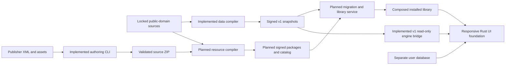

# Fontes system specification

Revision: **0.12**. Updated: **2026-10-17**. Status: **current working implementation baseline**.

Fontes is an offline-first Bible study application with a readable primary text, fast reference navigation, and an extensible library whose translations, paragraphs, word studies, topics, and user notes connect through stable identities. This specification consolidates the original Word specification, the data pipeline design, approved local UI references, the resource-library design, and the implemented authoring tools. Future implementation work must be understandable from this repository without the original chat or a file in someone's Downloads folder.

`MUST`, `SHOULD`, and `MAY` express a requirement, recommended default, and permitted option. They do not imply that a feature is implemented. **Implemented** means code/contracts exist; **partial** means only part exists; **planned** means required behavior still needs implementation; **deferred** means outside the current delivery phase; **open** means a decision or contract is not settled. Performance targets without measurements remain unverified requirements.

Contents: [authority](#1-authority-and-specification-maintenance) · [scope](#2-product-scope-and-actors) · [functional requirements](#3-functional-requirements) · [non-functional requirements](#4-non-functional-requirements) · [visual design](#5-visual-and-interaction-specification) · [flows](#6-user-and-operational-flows) · [schemas](#7-schema-and-contract-registry) · [packages/CLI](#8-resource-authoring-and-cli-specification) · [taxonomy](#9-concept-and-taxonomy-specification) · [installed library](#10-installed-library-and-update-specification) · [pipeline/publication](#11-source-pipeline-and-publication-specification) · [local AI](#12-search-and-local-ai-data-contracts) · [decisions](#13-decision-register) · [phases/acceptance](#14-implementation-phases-and-acceptance-criteria) · [open items](#15-open-decisions-and-release-blockers) · [history](#16-revision-history-and-original-requirement-traceability).

## 1. Authority and specification maintenance

This file is the entry point for product behavior, architectural decisions, requirements, flows, and acceptance criteria. Exact SQL, XSD, JSON, and Rust contracts are linked in section 7 and form part of this specification. Keep those files authoritative for the exact shape of their named version; duplicating them here would create competing schema definitions.

The [v0.1 Markdown transcription](docs/specifications/archive/bible-study-software-v0.1.md) preserves the complete original prose, SQL, and Rust examples with the source Word file's digest. It is historical. Its nullable range keys, integer translation IDs, mandatory lemmas, and single-analysis token shape are superseded by the versioned data contracts below. The original Word file has not been modified.

The [library/package detail specification](docs/specifications/library-and-packages-v0.2.md) and [pipeline architecture](docs/architecture/data-pipeline.md) provide supporting design detail. The [publishing guides](docs/resource-publishing/README.md) explain operations; the [source research](docs/research/public-domain-data-sources.md) preserves dated acquisition/licensing findings. Historical research statements about missing importers are not current implementation status.

Direct project-owner instructions take precedence. When a requirement, code, and contract disagree, record the discrepancy and reconcile the affected documents and implementation; never quietly reinterpret published bytes under their existing protocol/schema version. Draft package contracts can evolve before a production freeze, but the CLI, examples, tests, and docs must change together. Original FR1–FR10 and NFR1–NFR6 identifiers remain stable. New requirements and decisions get new IDs; retired IDs remain traceable. Changes to a decision must record what changed, why, and its migration/compatibility effect.

## 2. Product scope and actors

The primary user reads and studies Scripture, follows linked sources, and maintains private notes. A publisher/author prepares a resource and its metadata. A maintainer verifies provenance, rights, text/link quality, and taxonomy before publishing. Developers implement the shared local library and platform integrations against the same contracts.

The initial corpus is public-domain material, including preserved regional exceptions, with reading and study selections. The first additional-resource catalog offers **free resources with verified redistribution permission**. Free does not mean public domain. The architecture reserves appropriately licensed publisher resources and future entitlements; paid commerce is deferred. NLT is a possible future licensed edition, not an approved or currently distributable resource.

Application and shared data/library logic use Rust. The selected replacement presentation is React/TypeScript with HeroUI 3 in Tauri 2, shared by desktop and Android. Android is the first mobile target; iOS implementation is deferred. The older egui/eframe frontend remains available during migration verification. See [Tauri migration status](docs/app/tauri-migration.md). Stable typed command IDs are shared by the UI, CLI, JSON control and MCP stdio frontends; the core never depends on a toolkit. See the [application architecture](docs/app/architecture.md). SQLite is the selected embedded relational store. The local AI design uses an open-source local model, GGUF or equivalent, and local retrieval. Initial publisher tools may rely on bounded, documented build dependencies: SWORD 1.9.0 through the existing C++ extraction bridge, and `xmllint` for source XSD validation. Applications do not require SWORD or publisher XML tooling at runtime.

Out of current scope: cloud sync, multi-user collaboration, social features, mobile reading plans, full syntactic/clause parsing, advanced original-language diagramming, proprietary Logos/commercial import formats, cloud-dependent AI, publisher payments, DRM/entitlements, and a publisher portal. Detailed third-party morphology interchange, enrichment archives, and anchor-remapping interchange remain open contracts rather than supported features.



## 3. Functional requirements

### 3.1 Original application requirements

| ID | Required behavior | Implementation status |
| --- | --- | --- |
| FR1 | Support multiple translations; switch at any time while retaining canonical location, study context, and annotations. Start with public-domain texts; the reading corpus now includes KJV and WEB. | Implemented in initial v1 app; full package-native library later |
| FR2 | Provide a compact OT/NT book grid, current-book emphasis, progressively disclosed chapter/verse controls, persistent natural reference input (`John 3:16`, `j3 16`, abbreviations), recent/favorite locations, and mouse/touch/keyboard use with minimal scrolling. | Parser, staged picker, recent/favorites implemented; localization/accessibility audit remains |
| FR3 | Provide readable typography, configurable font/size/weight/line spacing/theme, optional verse numbers, smooth scrolling, chapter/verse navigation, and consistent notes/highlights. | Initial reading, seven selectable themes and size/typeface/spacing/numbers implemented; weight and richer text remain |
| FR4 | Desktop users MUST be able to select a word and right-click to look up its Strong’s number without leaving Scripture. Use verified edition-specific word links; show supplied surface/lemma/morphology, definitions and occurrence jumps. An aligned reading edition is required for the complete English-word workflow. Never infer an alignment from English spelling, position or shared Strong’s codes. | Edition-bound KJV Strong’s dictionary tags and desktop/mobile lookup implemented in the new Study build; 1 John 2:23 tags withheld for a text mismatch. OSHB Hebrew words/morphology and Greek source-word chooser implemented. WEB remains a verse-level chooser. Original-token identity is not inferred from dictionary tags. Published in data-v1-stable-8 with compatible app-v0.1.0-dev.10.1; physical-device verification remains separate |
| FR5 | Provide a book overview with author, date, audience, purpose, themes, outline, and summary, linked to its canonical range and available contextually and from study/navigation. Unknown/disputed fields stay unset or attributed. | Schema exists; reviewed records and app planned |
| FR6 | Provide navigable genealogies starting with Adam–Noah and Abraham–David and other major lines; people and relationships link to their actual scripture evidence. | Schema/mockups; curated records and app planned |
| FR7 | Surface commentaries, dictionaries, summaries, cross-references, and other relevant installed works from a selected verse/word without losing the primary reading context. | Desktop study stays in a resizable companion panel; grouped attributed articles/TSK targets implemented; paragraph-native library later |
| FR8 | Answer natural-language study queries locally through keyword + embedding retrieval; every answer cites canonical references and shows actual database verse text separately from generated explanation. Prompts forbid invented verses/references; runtime validation must enforce citation grounding. | FTS exists; embeddings/model/runtime/UI planned |
| FR9 | Create colored highlights and free-text notes for any canonical range, retain them across sessions, and show them in reading. Content updates/removal must preserve user-owned records. | Transactional persistent notes/highlights implemented; GUI single-verse creation, commands also support ranges |
| FR10 | Use one consistent palette, typography, radii, spacing, and interaction language for reading, menus, pickers, panels, dialogs, and settings. | Seven bundled palettes share semantic roles/fonts/icons across the responsive app; full platform/RTL/accessibility review remains |

FR4 does not authorize fabricated Hebrew morphology, lemmas, English word alignment, or glosses. Strong's definitions are not automatically lemmas. FR8 does not authorize a model to invent a citation because its system prompt asks it not to: resolve every returned reference and display its real text. If retrieval cannot support an answer, say so and expose available evidence.

### 3.2 Corpus, library, and publishing requirements

| ID | Required behavior | Implementation status |
| --- | --- | --- |
| FR11 | Compile approved exact source bytes into deterministic SQLite/FTS artifacts with provenance, coverage checks, notices, semantic diffs, and versioned GitHub releases. | Implemented for reading/study snapshots |
| FR12 | Discover upstream changes separately from compilation; propose reviewed lock/mapping/rights changes instead of silently importing moving URLs. Preserve exact accepted inputs by digest. | Retention/fetch implemented; scheduled discovery PRs planned |
| FR13 | Distribute logical works independently; represent reading/study as resource-selection bundles in the package-native app. Default updates must preserve optional installed works. | Design/contracts; delivery compiler and app planned |
| FR14 | Browse available resources using covers, title, authors, publisher, date/edition, description, scope, rights, size, capabilities, compatibility, and release notes without downloading archives. | Catalog schema; publication/client planned |
| FR15 | Install/update/remove selected resources safely, expose progress/errors and installed/update state, allow version pinning and explicit automatic-update preferences, and recover after interruption. | Installer/client planned |
| FR16 | A verse context lookup searches every installed work and navigates to the relevant block, explaining whether it matched coverage, citation, quotation, authored allusion, or a separately identified related topic. | V1 typed verse/article/word engine queries and UI implemented; full v2 paragraph graph later |
| FR17 | Preserve publisher-supplied and source-imported assertions separately from editorial enrichment, inferred suggestions, and user tags, with evidence/provenance. | Partial in current provenance/links; full v2 assertion layers planned |
| FR18 | Support a versioned concept registry with preferred/alternative labels, scope notes, multiple parents, related links, publisher proposals, reviewed mappings, and reversible deprecation/resolution. | Draft contracts and author validation; registry publication/client planned |
| FR19 | Provide author CLI scaffolding, strict XML/semantic validation, actionable diagnostics, deterministic packaging, and schema export. | Implemented in `fontes-resource` |
| FR20 | Review publisher identity, text/artwork rights, source fidelity, coverage, annotations, and concepts before trusted compilation/signing/publication. Public submissions must be authorized for redistribution. | Exact-hash source approvals and signed source publisher implemented; delivery/catalog and private intake service planned |
| FR21 | Preserve stable content anchors across updates and retain notes when blocks split/merge/retire or a resource is removed. | Canonical anchors/user schema implemented; block maps/migration planned |
| FR22 | Enforce permissions and attribution per resource for offline display, search, export, print, embeddings, and AI context. Installing works together grants no combined export/AI rights. | Source declarations/validation; client enforcement planned |
| FR23 | Automate PR submission checks, reproducible source preparation, and trusted signed release publication through reusable GitHub workflows. Separate tooling, submission, policy, and storage configuration; restricted sources/destinations must be private. | Implemented source stage; app delivery/catalog later |
| FR24 | Route durable app actions and domain queries through stable typed commands shared by the UI, CLI, JSON control and MCP server. Keep core/query/storage independent of egui/eframe/winit/wgpu; isolate platform startup and transient presentation. | Implemented initial 13-command engine/stdio contract and thin responsive UI; live GUI IPC later |
| FR25 | First launch MUST offer a path-free Reading/Study wizard, show authenticated download/storage sizes before payload transfer, download/verify/stage/open content, expose progress/cancel/retry and reopen installed content offline. Storage paths are app-selected; user notes survive setup failure. Preferences can reopen the wizard to choose a different legacy profile while retaining the current library on Back/cancel/failure. | Implemented v1 bootstrap service, GUI wizard and shared CLI setup. Android's unsupported standard file lock is corrected with native flock in published app-v0.1.0-dev.9.1. All seven release jobs pass, including 22 engine/bootstrap tests executed on Android API 28 x64; the same tests and a real Study download/open passed on API 36 arm64 locally. Physical-device networking/lifecycle, GUI graphics validation and full updater recovery remain gates |

## 4. Non-functional requirements

| ID | Requirement and verification |
| --- | --- |
| NFR1 | **Offline-first:** installed reading, navigation, word studies, genealogies, overviews, notes, and local AI work without network access. Missing optional data/model is reported explicitly. Network loss cannot disable installed content. Verify all implemented user flows with networking disabled. |
| NFR2 | **Performance:** reference selection/passage loading feel instantaneous on modest hardware; typical corpus-wide lemma/Strong's queries return in under one second. Measure cold/warm latency, corpus, hardware, and query set. Exact navigation budgets, reference hardware, and percentile gates remain open; an initial single-machine debug smoke run is recorded in [app verification](docs/app/verification.md), but it is not a cross-platform percentile benchmark. |
| NFR3 | **Platforms:** verify desktop behavior on Windows/macOS/Linux, Android as the first mobile target; defer iOS implementation explicitly. Share validation, query, and recovery behavior; isolate filesystem/background/lifecycle differences in platform adapters. |
| NFR4 | **Integrity:** validate actual canonical identity/existence, all references/ownership, witness consistency, coverage, SQLite integrity/foreign keys, search consistency, and verified package receipts. Existing canonical IDs cannot be deleted or reassigned by a source update; this tightens the original permissive cascade wording. |
| NFR5 | **Extensibility:** a new work in an already supported kind/profile requires data import and catalog entry, not a new core linking schema. New semantic features or unsupported interchange profiles require a versioned extension. |
| NFR6 | **Footprint:** retain the original goal of text + indexes under a few hundred MB before a local model. Reading SQLite is approximately 66 MB; the full study SQLite is approximately 585 MB with approximately 110 MB compressed transport. The full study set exceeds that original goal. Independent selection addresses choice, but does not prove a new budget; default bundle, device budgets, model/embedding sizes, and exceptions remain open. |
| NFR7 | **Reproducibility/provenance:** same pinned compiler/toolchain, lock/config/schema/registry/mappings, and source bytes produce identical SQLite and compressed artifacts in the supported build environment. Compare two real builds before publication; cross-platform byte equality is not assumed. |
| NFR8 | **Authenticity/compatibility:** authenticate exact signed bytes against app-configured trust/repository/channel; check supported versions/capabilities, hashes/lengths, and replay high-water marks. A download cannot supply its own trust root. |
| NFR9 | **Recovery:** cancellation, bad input, insufficient disk, failed validation, or process termination preserve a usable verified generation and user data. Platform fault-injection tests are required before shipping the installer. |
| NFR10 | **Input isolation:** bound actual extraction/decompression/XML/image work, reject unsafe files/unknown payloads, disable executable XML/SQL/extensions, and keep untrusted builds away from publication credentials. Verify with adversarial fixtures. |
| NFR11 | **Privacy:** user notes/private tags and AI inference stay local in the current product scope. No cloud model or account is required for public-free resource use. Public contribution requires a separate deliberate submission action. |
| NFR12 | **Usability:** preserve primary reading context, readable original-language glyphs, keyboard focus/navigation, configurable reading typography, recoverable failure states, and minimum mobile target sizes from section 5. Hebrew additionally requires correct RTL layout/shaping; font coverage alone is insufficient. Accessibility evaluation and toolkit support must be tested, not inferred from mockups. |
| NFR13 | **Diagnostics/maintainability:** source validation exposes stable error codes, file, available one-based line/column, explanation, and corrective help, with JSON output for CI/editors. Keep machine contracts/examples/tests/specs synchronized and mark partial implementations honestly. |
| NFR14 | **Engine boundary:** core commands, validation, queries and persistence MUST remain independent of UI/GPU toolkits and publisher tooling. UI, CLI, JSON and MCP MUST dispatch the same implementation. Queued native work MUST avoid blocking the render loop. Verify command parity, dependency layers and responsive error handling. |

## 5. Visual and interaction specification

The current working direction is **paper and sea glass**: warm ivory reading pages, dark ink, deep teal actions and pale blue-green selection surfaces, inspired by the owner’s ebook references. This replaces the dark study-desk default under D032; seven selectable palettes are now implemented under D036; final physical-device visual review remains open. See [UI assets](assets/ui/README.md). Exact selectable colors are in [themes.json](assets/ui/themes.json); default colors, type scales, spacing, radii, and dimensions are in [tokens.json](assets/ui/tokens.json); font/icon identities, hashes, provenance, and licenses are in [manifest.json](assets/ui/manifest.json), with Rust embedding helpers in [assets.rs](assets/ui/assets.rs). These assets are local and require no runtime download. Retain their licenses independently of resource licenses.

| Area | Current design choice |
| --- | --- |
| Palette | Seven selectable palettes share semantic page/chrome/sheet/feature colors. D037 adopts the owner-approved HTML composition: softly graded chapter headers and selections, rounded feature/definition cards, lighter bottom navigation and grouped action sheets. Android follows each palette’s light/dark foregrounds. Device verification remains separate. |
| Typography | Lora for Scripture; IBM Plex Sans Regular/Medium for UI; Noto Serif for Greek fallback and Noto Serif Hebrew for Hebrew fallback. Reading preferences can adjust the reading surface. |
| Mobile chapter heading | Owner-approved reference heading: 42 px (earlier native passes used 28 then 44 px), wrapping within the reader width for long book names. A single word wider than the reader scales just enough to fit intact. Desktop remains 38 px. Presentation-only change; no stored preference or schema migration. Static mobile mockups retain the earlier scale as historical references. |
| Original-language word heading | Verified supplied forms appear at 53 px within a 22 px rounded feature card, with transliteration, source-kind label and Strong’s code grouped beneath. The verse-word chooser retains 40 px forms. Dictionary headwords and verse forms remain explicitly distinct; no inferred alignment or invented lexical prose. |
| Icons | Official Phosphor Regular assets, tintable SVGs and 24/48 pixel PNG variants; use manifest roles. |
| Desktop layout | 1440 × 960 reference canvas, 208 sidebar, 800 reader and 432 study-panel reference widths. These describe design composition, not hard minimum window dimensions. |
| Desktop density | Approved compact sidebar: 36 px rows, 4 px item gaps, 6 px vertical saved-passage padding, 16 px section spacing. Navigation icons and labels align left with consistent inset and icon spacing; saved-passage labels also align left. These override earlier roomier sidebar mockups. |
| First launch | Reading/Study chooser → Continue (signed metadata discovery) → exact size confirmation → Download and open → progress/preparation/validation → reading. Primary actions stay at the bottom while content scrolls. Retry/cancel never require a filesystem path. Native style/tokens apply on desktop and Android. |
| Mobile layout | 390 × 844 reference canvas, 24 px chapter / 18 px verse horizontal insets, 44 px minimum tap/reference-cell target, 48 px ordinary actions, 64 px word lookup action and navigation surface. Handle real viewport/safe-area and text-size changes. |
| Reading toolbar | One continuous full-width surface with a bottom hairline; controls have transparent resting backgrounds and shared hover/press treatment. Mobile uses 44 px control heights, 4 px gaps and 16 px horizontal/8 px vertical padding. The passage expands into remaining space and truncates visually when needed; translation/bookmark/settings stay aligned. Narrow layouts retain the existing bookmark access through Notes. |
| Reference picker | One active Book, Chapter or Verse grid at a time. Choosing a book advances to chapters in place; choosing a chapter advances to verses at the top. Tapping a verse opens it directly. Fixed step tabs allow revisiting a choice, natural-reference input stays visible, and Open stays pinned for opening the current draft early. Recent/favorite shortcuts live with the book grid. |
| Android safe area | Read system-bar/display-cutout WindowInsets on Android’s UI thread, merge them with native content bounds without adding duplicate margins, and convert physical pixels at the current density/zoom. Constrain the shared root UI to egui’s safe content rectangle so toolbar, navigation, setup and picker controls avoid system UI. Refresh while idle and reject stale/empty geometry. Physical-device and broader IME/lifecycle validation remain open. |
| Selection actions | Mobile uses a dismissible bottom action sheet with verse context, a bounded selected-text preview, separate selection/verse groups, a 37 px selected-text preview, a 64 px primary lookup action, icon-led 48 px secondary rows, a grab handle and a secondary missing-alignment explanation. The body scrolls on small viewports; Close stays reachable. Desktop retains a grouped popup. Actions preserve existing selection, clipboard, annotation and lookup semantics. |
| Study articles | Render each supplied plain-text paragraph/line separately, with 16 px body text, 25 px line height, 12 px paragraph spacing, and a reading width bounded by the viewport and 640 px. Articles open at their beginning; returning restores the result list position. Repair the documented MHC double-escaped numeric character layer in future imports and legacy display without changing signed snapshots or other sources. Rich source emphasis/headings are not reconstructed from plain prose. |
| Desktop study | Study navigation and verse/word context actions retain the reader and open a resizable right companion panel. Group Words, Commentary, Cross-references and Topics; show readable article titles, excerpts and explicit open actions. Direct coverage is the default, with other mentions opt-in. Raw link codes and article IDs are not primary UI labels. |
| Secondary surfaces | Shared tokens. Mobile Reading preferences opens a bounded, dismissible bottom sheet over the current destination, with text size and a live selected-verse preview first, a fixed Done button, and theme/typeface/spacing/verse-number controls behind Theme & typography. Done/backdrop/Escape closes it; Library settings opens the existing full settings destination. Note editing is full-screen on mobile with save near the bottom. Word-study result sheets remain planned. |
| Mobile destinations | Read, Search, Notes, Study. Library/catalog entry placement remains open; do not silently invent a fifth tab as an established decision. |

[Mobile design references](design/mobile/README.md) cover reading, book selection, chapter/verse selection, contextual word study, notes/highlights, local AI search, genealogies, and reading preferences. They are static SVG/PNG mockups, not working application screens. [Figma handoff metadata](design/figma/handoff.json) records desktop references and pending work; pending scripts are not proof that interactions or compact-sidebar edits were applied remotely. The recorded export/prototype limitations are historical handoff state, not a fresh check of an account quota.

The reference picker advances in place through Book, Chapter and Verse steps; their grids are not stacked vertically. Word selection opens highlight, note, word study, copy, and ask-AI actions as data/permissions permit. Translation changes retain location and open panels. Genealogies and overviews are available contextually and through study surfaces. Generated AI explanation and quoted Scripture are visibly distinct. Detailed store wireframes remain open. The initial app uses a 760 logical-pixel mobile breakpoint, the 208 px compact sidebar, and a 360 px companion panel when the post-sidebar width exceeds 1,050 px. The narrow toolbar adapts and mobile actions remain reachable. Picker Open and note Save/Cancel stay at the bottom while content scrolls. These breakpoints and the [working flows](docs/app/README.md#working-flows) are implemented defaults still requiring device/accessibility validation. The mobile selection-action sheet is implemented; a sheet containing word-study results and richer contextual word selection remain planned. Lookup results still use Study navigation.

## 6. User and operational flows

### UF1 Read and navigate

Start with the last valid canonical range and translation, or an explicitly opened local v1 snapshot in the initial app. With no usable local library, run the implemented Reading/Study setup wizard: Continue fetches signed metadata, Download and open starts the confirmed transfer, and successful validation opens Scripture automatically. First setup requires internet; an offline seed is not bundled. Progress/cancel/retry and app-selected private storage replace the old path prompt. Open the picker or type a natural reference; seed the draft from the current passage and show a compact OT/NT grid with current-book emphasis. A book tap replaces that grid with chapters; a chapter tap replaces it with verses at the top. Step tabs revise earlier choices without changing the reading location. A verse tap opens it immediately; pinned Open can open the current draft before choosing a verse. Validate input before navigation and retain the current passage on an invalid reference. Open the chosen range, update recent locations, and allow favorites. Translation switching preserves the canonical range, annotations, and study context; unavailable source verses remain explicit rather than fabricated.

### UF2 Study a verse or word

Select Romans 1:3 or a word. On desktop, drag or double-click to select Scripture text, then right-click. With an explicit source/reviewed word link, offer each associated Strong’s number and open its dictionary in the companion panel. If no link exists, say so and offer original words for the whole verse; do not suggest the chosen Greek word is an established translation of the English selection. The current snapshots use this fallback, so exact English-word lookup is still a data delivery gate. Preserve selection when opening the menu and provide copy-selection and verse note/highlight/copy actions.

Study navigation and “Study this verse” keep the desktop passage visible and its reading location intact. Use Words, Commentary, Cross-references and Topics sections. Show direct coverage first, with narrower source ranges before chapter coverage; additional article mentions are opt-in and clearly identified. Cross-references show named canonical targets with actual active-edition first-verse previews and source-article actions, bounded to 100 distinct ranges. A range jump currently selects its first verse. Open article text, attribution and actionable scripture links in that same panel. Selecting another verse refreshes its resources; switching translations invalidates text selection and uses only the new edition’s word links. Group source analyses by witness and word position; preserve alternative analyses without duplicating every word row. Occurrence/reference jumps update the reader and companion context together. On narrow/mobile layouts, selection actions open a bottom sheet; lookup results still use the Study destination. A word-study results sheet and device-specific selection gesture validation remain planned.

### UF3 Add or edit an annotation

Select a canonical range, choose highlight color or enter note text, then save in `user.sqlite`. Cancel discards the current edit. Reloading and content replacement retain the record. Store optional resource/block or word anchors with a quoted fallback; if a resource is absent or an optional anchor no longer resolves, keep the scripture note and show that state rather than moving/deleting it silently.

### UF4 Ask the local library

Enter a question. If the local model/index is missing, describe what is unavailable and keep ordinary search/reading usable. Retrieve only installed, permitted content through local FTS and the compatible optional vector index; pass identified evidence to the model. Validate cited references against the registry and retrieved evidence, render actual verse text from SQLite, and label generated explanation separately. Open citations in reading. Unsupported claims yield an insufficient-evidence response. Model selection, context limits, cancellation UX, and benchmarks remain open.

### UF5 Browse, install, update, or remove a work

Read the last verified catalog offline or refresh it when online. Show cards with independent cover assets and detail metadata. Selecting a card opens a detail surface with description, contributor/publisher, rights/credits, scope, supported study features, compatibility, versions, download/storage estimates, and install/update state. Incompatibility explains the needed app/capability. Show required dependencies and total space before selection proceeds.

Download only the selected work/dependencies, verify/stage/compose/activate as specified in section 10, and change to installed state only after successful activation. Reopen the verse context menu to see its newly linked paragraphs immediately. Update preference/version pinning is explicit; bundles/recommendations do not silently add books. Removal uses the same recovery path and handles required dependents explicitly, preserving unrelated works and notes. Cancel/failure leaves the previous library usable. Detailed catalog layout and private local-import UX remain open.

### UF6 Author, validate, and submit

Run `fontes-resource init` with identity and optional metadata; edit its chapter/paragraph content, cover, rights, navigation, and annotations. Validate directory or ZIP, follow file/line/column diagnostics and help, rerun after fixes, and use `--deny-warnings` for a finished draft. Pack to an immutable source ZIP. Submit authorized open content under this repository's `library/submissions/` through a reviewable source directory or locked HTTPS archive descriptor. PR checks use trusted base policy and retain diagnostics/previews; a maintainer records exact canonical-source hash approval before trusted publication. Uncertain/restricted rights require private intake before public upload. The same workflows can later operate in another/private repository. There is no submission portal, paid entitlement service, or automatic author approval.

### UF7 Propose or standardize a concept

Search registry labels/aliases and read scope notes. Reuse the stable ID if the meaning fits; otherwise declare a publisher-owned concept with labels, scope, evidence, and relationships. Validation checks ownership/graph/references. A maintainer compares meanings and records a new central concept, alias, equivalence, relationship, or distinct concept. Publish a signed registry revision; installed assertions retain original IDs while effective query mappings improve discovery. Authors may adopt central IDs later. Similar labels alone never authorize a merge.

### UF8 Refresh sources and publish

Discovery observes upstream changes and creates a proposed lock/rights/mapping diff. A maintainer reviews it; trusted CI acquires exact bytes, normalizes, builds, validates, and compares reproducibility/diffs. Only the publishing job receives signing/write credentials. Upload to a draft, verify uploaded assets, publish the new sequence, and verify public downloads. Resource-native publication verifies delivery assets/covers/taxonomy before a catalog references them. Discovery outage or invalid input leaves current local content and published releases usable.

## 7. Schema and contract registry

### 7.1 Implemented v1 snapshot contracts

| Contract | Authority and meaning |
| --- | --- |
| Canonical identity | [registry-v1.json](data/canonical/registry-v1.json): permanent book allocations and actual chapter/verse counts; 66 books, 1,189 chapters, 31,102 atomic anchors |
| Content SQLite | [content-v1.sql](data/schema/content-v1.sql): complete immutable profile schema, `application_id`/`user_version`, strict tables, views, indexes, and FKs |
| User SQLite | [user-v1.sql](data/schema/user-v1.sql): separately mutable notes/highlights, local canonical ranges, saved references, and update high-water state |
| Shared Rust contracts | [fontes-data-contracts](crates/fontes-data-contracts/src/lib.rs): source lock, profiles/release fields, capabilities, version constants, and structural checks |
| Acquisition/config | [sources.lock.json](data/sources.lock.json), [profiles.json](data/profiles.json): exact ten source identities and required profile membership/capabilities |
| Reviewed mappings | [reading-v1.json](data/mappings/reading-v1.json), [study-v1.json](data/mappings/study-v1.json): source-bound versification/omission rules and citation anomaly baseline |
| Trust and example | [data-release-1.json](data/trust/data-release-1.json) is a public key; [example release manifest](data/examples/release-manifest.json) is an unsigned fixture, never a live release |

Canonical reference IDs use `book_id * 1_000_000 + chapter * 1_000 + verse`; components are 1–999, but actual registry existence is also mandatory. John 3:16 is `43003016`; Romans 1:3 is `45001003`. Atomic references and inclusive `reference_ranges` are separate. Never derive IDs from localized names, input order, or current translation coverage. Registry expansion allocates new permanent IDs with versioned compatibility; existing anchors cannot be repurposed.

| Domain | Key v1 entities and invariants |
| --- | --- |
| Provenance | `source_snapshots` binds digest, URL, upstream revision, rights review, and adapter version |
| Text editions | `text_witnesses`, `source_segments`, `segment_refs` retain edition/versification and original keys, including split/merged/partial mappings |
| Translations | `translations`, `verse_texts`, `verses_by_reference` map text through source segments; range rendering deduplicates merged segment IDs |
| Words | `strongs_codes`, witness-specific `lemmas`, `original_tokens`, alternative `token_analyses`, many-to-many `token_strongs` preserve source distinctions |
| Alignment | `word_alignments` stores source/reviewed links only; offsets are zero-based Unicode scalars with an exclusive end in exact normalized verse text |
| Study content | Current `resources` are source articles/entries; `resource_links` targets exactly one range, Strong's code, or lemma with a typed relation |
| Genealogies | `persons`, `genealogy_edges`, `genealogy_edge_refs` separate stable person identity, parent/ancestor/legal-parent relationship, and multiple evidence ranges |
| Overviews | `book_overviews` stores reviewed summaries with nullable unsupported metadata and source-resource provenance |
| Search | `search_documents` identifies verse or resource text; external-content `search_fts` uses FTS5 and must remain synchronized |
| User data | Independent registry/ranges allow annotation FKs without a cross-database FK; optional text/translation anchors supplement the permanent range |

Schema presence does not imply populated data or working features. The current corpus has no reviewed genealogy or structured-overview dataset, Hebrew token morphology, reliable English word alignment, embedding index, or AI model. Morphology codes name their coding system; both Robinson reading streams and their alternative analyses remain distinct.

### 7.2 Resource source and discovery contracts

The [package contracts](specs/resource-packages/v1/README.md) define format/protocol version 1. The current source CLI enforces the supported prose/verse profile, and the source-release protocol is implemented. Catalog/delivery/library v2 contracts remain drafts and are not live.

| File | Defines |
| --- | --- |
| [common.xsd](specs/resource-packages/v1/common.xsd) | Namespace types, IDs/paths/versions, typed references, inline vocabulary, permissions |
| [metadata.xsd](specs/resource-packages/v1/metadata.xsd) | Identity, contributors, publisher/date/edition, coverage, cover, rights/permissions, provenance |
| [index.xsd](specs/resource-packages/v1/index.xsd) | Ordered documents/sections, IDs and content paths |
| [content.xsd](specs/resource-packages/v1/content.xsd) | Document and stable block identities, text/inline markup, scripture/concept/word annotations |
| [concepts.xsd](specs/resource-packages/v1/concepts.xsd) | Publisher proposals or registry snapshot, labels, scopes, broader/related/evidence |
| [catalog.schema.json](specs/resource-packages/v1/catalog.schema.json) | Complete catalog snapshot, bundles, card/detail metadata, cover variants, rights, dependencies, artifact compatibility/hash/size |
| [delivery-manifest.schema.json](specs/resource-packages/v1/delivery-manifest.schema.json) | Compiled payload identity, publisher/version/build, source/compiler, schema/capabilities, per-file inventory/hash/size |
| [submission.schema.json](specs/resource-packages/v1/submission.schema.json) | Implemented source submission descriptor: identity/version/build, source path or bounded locked HTTPS archive, release notes |
| [publication-policy.schema.json](specs/resource-packages/v1/publication-policy.schema.json), [approval.schema.json](specs/resource-packages/v1/approval.schema.json) | Implemented trusted distribution/publisher/host/registry/trust policy and exact-source-hash maintainer approval |
| [source-release-manifest.schema.json](specs/resource-packages/v1/source-release-manifest.schema.json) | Implemented source-stage release inventory/signature/provenance; not the compiled app delivery format |
| [library-model.sql](specs/resource-packages/v1/library-model.sql) | Scratch executable ownership/linking/concept/search model; **not** a complete v2 schema or migration |
| [Romans example](specs/resource-packages/v1/examples/romans-study/) | Complete small source package; fictional publisher and original example text/artwork |

Catalog/delivery JSON examples contain synthetic zero hashes and unavailable URLs. The taxonomy example is illustrative, not the live registry. No fixture is a trusted installable artifact. XSD validation cannot establish rights, publisher authority, source fidelity, or editorial approval.

### 7.3 Intended library schema v2

One composed `library.sqlite` contains active installed content. Every publisher-owned node, witness, segment, token, assertion, asset association, and search document has package ownership. Package identity is a **work/edition**, distinct from v1 article-level `resources`. Stable content anchors are `(resource_id, local_node_id)`; source paths and row positions are not identities.

Shared canonical anchors, Strong's identities, and concepts are never removed just because one package is uninstalled. Scripture assertions link a block to canonical start/end FKs and retain relation, basis, and provenance. Word links use shared codes or witness-qualified identities. Concept assertions preserve submitted IDs; reviewed resolution supplies effective IDs without rewriting source claims. Missing optional target works use qualified availability-aware links rather than mandatory FKs into absent content.

User-owned records remain in `user.sqlite`, with its local permanent reference registry. No foreign key is assumed to cross databases. The local active pointer and its database/installed-set receipt define installed state; `user.sqlite` must not hold a second independently committed authoritative package list. The complete v2 DDL, payload exchange table allowlist, migrations, and anchor map are open release blockers in section 15.

### 7.4 Independent version axes

| Axis | Current value or policy |
| --- | --- |
| System specification | This document, revision 0.11; does not set data/protocol versions |
| Content/user SQLite schemas | Published content v1 and user v1; composed library v2 remains a design target |
| Canonical registry | v1, `fontes-protestant-66-v1`; permanent IDs never reassigned |
| Snapshot manifest/update protocol | v1, separate from the package/catalog protocols |
| Application commands/session extension | Initial command protocol v1 and additive `fontes_app_session_v1`; independent of content/library schema versions |
| Resource XML source format | Draft v1, namespace `urn:fontes:resource:1` |
| Resource delivery/catalog protocols | Draft v1 each; no live signed catalog or compiled delivery format yet |
| Source-release protocol | Implemented v1, `validated_source_package`, with a separate signature domain and preview release tags |
| Resource content version | Publisher numeric `major.minor.patch`; immutable released source bytes |
| Delivery build revision | Positive compilation revision for fixed resource source bytes |
| Taxonomy snapshot | Separate registry revision; checked-in snapshot is illustrative only |
| Release/catalog sequence | Monotonic within its configured repository/channel/versioned line; not a resource version |
| Source/adapter/compiler/app | Exact source digest/revision, adapter version, compiler commit/toolchain, and compatible app version remain independent |

Content corrections do not inherently need an app release. Contract/schema changes require compatible code and an explicit version/migration policy; publication timestamps and sequences do not redefine content identity.

### 7.5 Implemented initial application contracts

The [application command specification](specs/app/README.md) and generated [commands-v1.json](specs/app/commands-v1.json) describe 13 stable command IDs and strictly typed inputs shared by GUI/CLI/JSON/MCP. [`fontes-engine` view models](crates/fontes-engine/src/model.rs) define the serializable replies. This application protocol version is independent of snapshot/update and package-library versions. It is the initial development API, not a promise that all view-model fields are frozen for external consumers.

The engine opens trusted local content-v1 snapshots read-only and uses the existing separate user-v1 schema. It adds only `fontes_app_session_v1(singleton, json)` for typed last selection/translation/reading preferences without changing published user-v1 version or tables. Missing translations fall back to an installed one; canonical note anchors remain stable. The implemented v1 bootstrap service verifies and activates whole signed snapshots in separate app-owned `snapshots-v1` generations; it does not mutate snapshots or implement a library-v2 migration. Its stable operation identity is `library.setup`, shared by GUI and CLI before the initialized Engine exists, not a new JSON/MCP domain command. See [first-run setup](docs/app/first-run-setup.md). [`docs/app/architecture.md`](docs/app/architecture.md) records storage, concurrency, bootstrap and future migration boundaries; [`docs/app/README.md`](docs/app/README.md) records exact local usage and platform dependencies.

## 8. Resource authoring and CLI specification

### 8.1 Artifacts, identity, and layout

The **source archive** is editable publisher XML/assets: `<resource-id>--<version>.fontes-source.zip`. A trusted Fontes build will produce a separate **delivery archive**: `<resource-id>--<version>--b<build_revision>.fontes.zip`. The app browses a small **catalog** with independently hosted covers; it never downloads a large archive merely to inspect metadata.

Resource IDs are verified publisher namespaced, for example fictional `org.example.romans-study` under `org.example`. Titles, covers, and ISBNs do not prove identity/authority. Resource versions are numeric `major.minor.patch`, without leading zeros or prereleases in the initial format. Released source identity/version bytes are immutable. Compiler corrections increment a positive build revision; changed source content/metadata/artwork/rights increments resource version. Preserve document/block IDs through rewording or moves. Splits/merges/retirements need reviewed anchor maps.

```text
metadata.xml
index.xml
rights/LICENSE.txt
rights/ATTRIBUTION.txt
assets/cover.png                 # or cover.jpg
content/introductions/romans.xml # optional; indexed when present
content/rom/001.xml
taxonomy/concepts.xml            # optional publisher proposals
media/figure.png                # optional referenced content image
```

Files are at the ZIP root without an enclosing directory. A chapter per content file is recommended; short books can use one file and dictionaries can shard entry groups. Reading order comes from the index, not alphabetical filenames. Each content file is indexed exactly once, and blocks do not span files. Source markup is UTF-8 in namespace `urn:fontes:resource:1`; schema definitions ship with tooling and are not fetched from package URLs.

Supported resource kinds are translation, commentary, lexicon, word-study, study-guide, devotional, and book. Blocks are paragraph, heading, verse, note, list-item, or entry. Inline markup supports emphasis, scripture references, Strong's codes, concept terms, and local images with alt text. Unknown markup, SQL/scripts/plugins/fonts, and unlisted payloads are rejected. Detailed morphology occurrence exchange, richer tables, and footnotes require separate profiles; trusted existing adapters may preserve structured tokens through an internal normalized compiler path.

### 8.2 Metadata, assets, and annotations

Metadata includes title/subtitle/description, contributor roles and optional identities, publisher identity/name, language, edition/date, source versification, canonical registry, selected/complete coverage, source/provenance identifiers, cover, and separate rights statements/files. Explicit permissions cover offline display, keyword search, export, print, embeddings, and AI context. Cover license/rightsholder/credit is separate from text rights. Territorial/platform restrictions require review; withhold titles when the current public mechanism cannot honor their terms.

| Limit | Initial contract/validator value |
| --- | --- |
| Master cover | Exactly 1200 × 1800 PNG/JPEG, at most 4 MiB |
| Published cover variants | 200 × 300 card and 600 × 900 detail; catalog binds type/dimensions/length/hash and artwork credits |
| Content images | PNG/JPEG, at most 16 MiB, 8192 pixels per dimension and 16,777,216 total pixels |
| XML | At most 16 MiB/file, 32 element nesting levels; no DTD/entities/XInclude/processing instructions |
| Archive | At most 10,000 entries and 1 GiB actual expanded bytes |
| Paths/navigation | Portable case-sensitive ASCII relative paths, at most 240 bytes/32 components; navigation at most eight section levels |

Reject absolute/traversal/backslash paths, duplicates/case collisions, symlinks, special files, encryption, and external assets. Count actual bytes rather than trusting ZIP size declarations; decode images rather than trusting metadata. Image references are package-root paths under `media/`.

Use `text-of` for a translation mapping, `applies-to` for coverage, `cites` for a reference, `quotes` for quoted text, and `alludes-to` for a supplied implicit link. Resolve all endpoints against actual canonical existence and retain original source references/known quotation witness. An inline reference creates an indexed citation; annotate the smallest useful paragraph for precise context lookup. Source omissions have no invented text. Complete translation coverage requires all declared anchors accounted for, including explicit omissions.

Strong's IDs normalize to `G0001`–`G5624` and `H0001`–`H8674` for the present editions. Authored/source assertions are distinct from Fontes editorial and machine suggestions; inferred links require their method/version/confidence and remain visibly identified. The current public XML assertion basis is author/source; expanded internal provenance is a separate layer.

### 8.3 Implemented commands and diagnostics

[CLI installation, flags, error codes, and examples](docs/resource-publishing/cli-guide.md) are operational documentation. The [Rust library](crates/fontes-resource/src/lib.rs) exposes the same scaffold/validation/pack behavior for reuse. `xmllint` is currently required on `PATH` for strict XSD validation; this is an explicit dependency, not a self-contained XML schema engine claim.

| Command | Contract |
| --- | --- |
| `fontes-resource init DIRECTORY` | Require resource/publisher IDs; accept optional title/subtitle, description, repeatable author, publisher, edition/date, language/version, source versification/coverage, cover/credits, license and attribution files. Create required files/folders and editable content; refuse existing destinations and invalid metadata. |
| `fontes-resource validate SOURCE` | Accept a directory or ZIP; enforce embedded XSDs plus semantic identity/index/media/registry/word/concept/coverage/asset checks. Use explicit `--taxonomy PATH` for registry concepts and `--deny-warnings` for unfinished drafts. |
| `fontes-resource pack SOURCE --output ARCHIVE` | Validate a private snapshot and archive exactly those bytes in fixed order/timestamps/permissions; output filename must match identity/version; print path/hash/length, refuse overwrite. |
| `fontes-resource schemas --output DIRECTORY` | Export embedded XSDs with local includes to a new directory. |

Scaffolding creates a clearly identified CC0 placeholder cover and TODO text; it grants **no** permissions for the resource's text. Rights flags remain deny until actual grants are supplied. Passing structural checks does not make this a publishable resource. `--deny-warnings` rejects pending rights/template content, but human approval remains necessary.

Diagnostics contain severity, stable code, root-relative source file, one-based XML line/column where available, issue, and basic corrective instructions. Missing media points to the referencing XML attribute. Global/binary/missing-root-file errors have no invented XML position; XSD columns are supplied only when locatable. Collect structural errors across files first, then run semantic checks after structure is safe. `--format json` and optional external `--report` produce `report_version: 1`; never write a report into the source payload or overwrite an existing one. Validate exits 0 valid, 1 invalid, 2 operational/invocation failure; other command failures exit 2.

Planned tools: format converters, preview, semantic diff, concept search/proposal helpers, and submission preparation. They are not installed commands or a live publisher service.

The implemented `submissions check/build/publish/verify` commands additionally validate repository descriptors, prepare all or only approved source releases, sign/publish/verify through GitHub, and authenticate downloaded source assets. A preview image/metadata release is not the planned interactive resource preview tool. See [the submission pipeline](docs/resource-publishing/submission-pipeline.md) for exact commands and contracts.

## 9. Concept and taxonomy specification

Use stable URI identities, localized preferred/alternative labels, scope notes, status/provenance, multiple broader parents, and related links. The graph permits multiple parents, forbids broader cycles, and deduplicates traversal. Labels are not identities; aliases denote the same meaning, while broader/narrower and related concepts remain distinct.

“The Flood” and “Noah's Flood” can label the Genesis 6–9 narrative. “Global Flood interpretation” has a narrower/related scope; it is not an unconditional synonym assigning a global-extent claim to every resource discussing the narrative. The desert of Sin and moral sin remain different concepts. Search offers exact/alias results first and clearly labeled hierarchical expansion; topic association is not an invented scripture citation or endorsement.

Publishers propose `urn:fontes:publisher:<publisher-id>:concept:<local-name>` concepts with one preferred label per included language, scope, optional aliases/parents/related IDs, and evidence. They cannot define the central namespace. Similarity detection may suggest duplicates but never auto-merge. Review can create a central concept, add a label, approve equivalence, add a relationship, or retain distinct scopes.

Only reviewed equivalence resolutions flatten submitted IDs to effective IDs. Preserve original assertions, review identity/evidence/revision, deprecation redirects, and reversibility. Close matches and broader/related edges never collapse transitively as equality. Signed registry updates improve installed queries without requiring every author to republish. A new concept alone does not tag older books: separate signed editorial enrichment must bind exact target resource/block identities/hashes and evidence. Its exchange contract is still open. Private user tags stay local unless explicitly submitted.

## 10. Installed library and update specification

### 10.1 Unified local graph and generation lifecycle

Independent distribution does not imply independent installed databases. Compose installed works into one known `library.sqlite` so canonical, paragraph, word, concept, ownership, and search joins operate across the library. Keep `user.sqlite` separate. A locally composed DB has local hashes and receipts for signed inputs; it must not claim to be the unchanged publisher-signed snapshot.

```text
user.sqlite
library/active.json
library/previous.json
library/generations/<local-generation-id>/library.sqlite
library/generations/<local-generation-id>/installed-set.json
library/downloads/<sha256>.part
library/staging/<job-id>/...
assets/<sha256>...
```

1. Authenticate catalog/selection, identity, compatibility, permission scope, required dependency closure/cycles, and bounded download/expanded sizes. Calculate staging/journal/assets/rollback space. Active, previous, and candidate can require three full DB copies; show the actual estimate rather than only package size.
2. Download to a partial file, verify exact signed length/hash, extract safely, verify manifest signature and complete payload inventory, decode assets, and validate the exchange schema. Never execute supplied SQL/migrations/triggers/extensions. Optional absent works do not invalidate canonical links.
3. Acquire one library mutation lock and use SQLite's consistent backup API to create a candidate copy, or initialize one for first install. Freeze other mutations during cloning; readers continue. Copying only an open main file while ignoring WAL/journal is not a backup strategy.
4. In one explicit candidate transaction, replace only selected packages' owned rows, apply mappings/receipts, maintain FTS and derived indexes, and check surviving dependencies. Do not cascade through another package's content.
5. Validate whole-candidate integrity/foreign keys, ownership, counts, coverage, linking, search, permissions, installed-set receipt, and assets. Checkpoint/close and flush files/directories with platform primitives.
6. Atomically activate the complete candidate pointer and retain the previous verified pointer. Existing readers finish on old handles; new queries use the new generation. Platform code must implement and test Windows/mobile filesystem semantics explicitly.
7. On restart recover from staging/pointer interruption using the previous verified generation or bundled seed. Keep a rollback generation through health checks and reader release. Asset cleanup accounts for active, previous, staging, and in-flight readers. A failure discards/rejects the candidate; never restore over a live serving DB.

Update and uninstall use the same lifecycle. A removed work's note survives with an unavailable-resource state. Required dependents must block removal or be an explicit removal selection. Rebuild/update external-content FTS in the same candidate operation; deleting search rows alone does not remove postings. Transaction-only incremental mutation is a future optimization requiring equivalent recovery evidence.

### 10.2 Discovery, replay, compatibility, and withdrawal

The owner-approved initial bootstrap is a confirmed online Reading/Study wizard; it bundles registry/trusted keys, downloads the selected whole signed v1 profile and reopens it offline thereafter. A bundled offline reading seed remains planned, so first launch without prior content requires a connection. This replaces the earlier path prompt, not the future package-native installer/update lifecycle. [The implemented bootstrap contract](docs/app/first-run-setup.md) defines bounded discovery, trust, replay, validation, versioned app-owned receipts and atomic activation; the remaining requirements below govern the full updater. Check updates on request and, while running/online, at most daily by default with jitter; respect battery/metered settings. Use bounded requests/pagination, caching, conditional fetches, backoff, and restart/resume behavior. OS background work is optional. Resume only when object validation/range semantics establish the same bytes. Keep local content if discovery is unavailable/incomplete.

Select the highest compatible **verified sequence**, never lexical tag order or the repository's generic latest release. Persist a repository/channel/protocol-specific high-water mark; the current snapshot schema keys it by repository/channel/content schema. Local rollback does not lower that mark; server rollback publishes a higher sequence. Versioned app support precedes schema/protocol changes. Retain compatible local content when an older app cannot install a newer package.

Each catalog is a complete availability snapshot with one advertised version/build per resource ID. Withdrawal omits the work and removes it from bundles in a new signed sequence. Clients stop offering new installs after refresh; offline clients cannot learn a withdrawal until then. Installed content and user notes are not silently erased. Reasons/replacement decisions remain in review history; structured replacement notices need a contract extension. Rights terms continue to apply to cached packages.

## 11. Source pipeline and publication specification

### 11.1 Initial data and source policy

`reading` requires KJV + WEB. `study` additionally requires Greek/Hebrew Strong's, Robinson TR with both reading streams, Matthew Henry, Nave, and TSK. Exact source bytes, acquisition URLs, hashes/lengths, revisions, adapters, and dated rights review IDs are in the lock. Missing required sources/adapters fail a profile rather than silently reducing its advertised capability.

Maintain the public-domain default policy and recorded exceptions/notices, including KJV regional rights. D034 adds an owner-approved CC BY 4.0 exception for reviewed Hebrew word data, with attribution and modification notices. D035 adds the separately approved GPL KJV dictionary annotation layer with exact editable sources, credits and GPL text. General public-free catalog permissions are reviewed separately. Do not import modern annotation layers, other CC BY/SA morphology/genealogies, or conditional tagged editions merely because their underlying Bible text is public domain. Each source still requires a separate rights review. Publisher and artwork review is required independently. Research candidates are not the production allowlist.

The v1 baseline has 62,204 translated verse rows; study has 64,090 source resources, 281,240 Greek tokens, 281,307 analyses, 281,330 Strong's associations, 15,914 Greek segments, and 385,194 TSK target ranges. Strong's dictionaries have 5,624 Greek and 8,674 Hebrew entries. These are baseline regression evidence, not immutable counts for every future edition.

Retain the 439 known source citation anomalies (353 Matthew Henry, 26 Nave, 60 TSK) as source text and diagnostics bound to exact sources/records; keep valid portions of citation lists linked. A changed anomaly baseline requires explicit reclassification. No invented correction, lemma, genealogy, or overview fills an upstream gap. Genealogies need stable disambiguated person IDs, distinct parent/ancestor/legal-parent meanings, evidence per edge, and cycle review. Overviews need reviewed and attributed content rather than guessed historical fields.

### 11.2 Build and source refresh

Discovery may inspect moving upstream revisions; compilation consumes only reviewed exact inputs/config. Proposed weekly/manual discovery creates one update PR with source/rights differences and semantic change report. Changed/missing rights evidence prevents automatic acceptance. Accepted raw inputs are retained by digest and retrievable from prior permitted release assets; a CI cache is not the only archive.

Acquisition verifies sizes/hashes before adapters. Trusted adapters preserve source identity and structured data, normalize deterministically, and populate known tables. SWORD extraction enumerates aliases/linked keys and retains all key-to-resource mappings; TSK context and Robinson alternatives/apparatus must survive. JSONL intermediate serialization was proposed in the architecture; the current compiler uses Rust normalization and SQLite insertion, and no stable public JSONL interchange contract exists.

Build snapshots from scratch in deterministic order with pinned dependencies/toolchain, stable content/search identities, and no volatile publication timestamps in database identity. The logical content ID binds source/config/schema/registry/mapping/compiler inputs; file hashes identify exact bytes. Check integrity, foreign keys, required coverage/counts, FTS, representative passage/word queries, source diagnostics, and semantic additions/changes/removals. Rebuild twice and compare SQLite/compressed bytes in the supported CI environment. Missing capabilities must not be advertised because their tables exist.

### 11.3 Versioned releases and trust

Current [data-contracts](.github/workflows/data-contracts.yml) and [data-release](.github/workflows/data-release.yml) workflows test/build/publish snapshots. Release runs on relevant trusted-main changes or manual dispatch. The signing job is separate from acquisition/parsing, receives the configured signing secret and minimal write permission, and serializes release allocation. PR/untrusted compilation never receives signing credentials or runs contributor-supplied executable adapters. Pin toolchain/dependencies/action revisions; container image digest pinning remains a reproducibility hardening task.

Allocate a new monotonic sequence including prior reserved/draft sequences; use `data-v<schema>-<channel>-<sequence>` tags bound to the compiler commit. Identical logical input/compiler content is a publication no-op. Never overwrite published bytes. Create a draft, upload the full asset set, verify it by download, publish with data releases separate from generic app latest, and verify public downloads. Preserve reading when adding/updating study. Keep source assets, notices, lock, validation/import reports, and semantic diffs for audit; do not imply every audit asset is independently bound by the v1 signature.

Current snapshot manifests bind repository/channel/sequence/tag, compiler/lock/source identities, versions, capabilities, counts, and each compressed/uncompressed length/hash. The verifier limits each profile to 256 MiB compressed and 1 GiB SQLite and validates actual output. Those limits are protocol safety bounds, not product footprint targets. Audit assets/fixtures are not app installation inputs.

| Signed object | Domain prefix before exact original UTF-8 JSON bytes |
| --- | --- |
| Current snapshot manifest | `FONTES-DATA-MANIFEST-V1` followed by one newline byte |
| Draft library catalog | `FONTES-LIBRARY-CATALOG-V1` followed by one newline byte |
| Draft resource manifest | `FONTES-RESOURCE-PACKAGE-V1` followed by one newline byte |
| Implemented source-release manifest | `FONTES-RESOURCE-SOURCE-RELEASE-V1` followed by one newline byte |

Detached Ed25519 signatures are 64 raw bytes. Trust roots and expected repository/channel/versions come from the app, never the downloaded object. Check the signing key identity against the verified key. A mutable latest pointer is discovery only. Keys stay outside Git; public keys may be committed. Snapshot rotation uses an app trust-policy update before publisher switchover; package/catalog rotation, emergency revocation, and offline trust policy require completion before production.

### 11.4 Resource-native publication

Current free source intake lives under this repository's [library/](library/README.md). A future dedicated `fontes-library` repository remains an option; its owner/URL and private rights contact are unprovisioned. Store small approved source directories, metadata, recipes/descriptors, reviews, concept proposals, and reports in Git. Put large immutable ZIP revisions in release/object storage. Fixed tooling fetches bounded inputs by hash and never executes a submitter's script. Restricted/uncertain works go through private intake before public upload.

Trusted CI will normalize each approved source into `content.sqlite`, `metadata.json`, cover/media, `NOTICE.txt`, `manifest.json`, and its signature. The delivery manifest binds complete payload entries except itself/signature, source archive digest, compiler identity, package/version/build, library schema, registry/taxonomy, and required capabilities. The importer allows only a defined exchange schema; its full DDL/allowlist is not yet specified.

Generate catalog/card metadata and cover variants from the approved compiled metadata, bind `metadata_sha256` to exact `metadata.json`, verify repeated fields and dependencies, upload/verify assets first, then publish the next signed catalog sequence. Rights approval is not a publisher-supplied metadata flag. Public and future restricted payloads need separate distribution/authorization policies.

### 11.5 Implemented source-submission automation

The current [submission pipeline](docs/resource-publishing/submission-pipeline.md) implements the source stage now: read-only PR validation with trusted base policy; frozen canonical ZIP, metadata, notices, and cover generation twice with byte comparison; exact-hash approval; and a separate trusted publisher that signs an asset inventory, verifies draft downloads, publishes a prerelease, and verifies published downloads. Source tags are `resource-source-<id>--<version>--b<revision>` and never replace generic latest releases. Identical retries reuse verified existing bytes; complete drafts can resume; collisions or changed source under a released version are refused.

The reusable build and publisher workflows keep source checkout, trusted tooling, trusted caller policy/approvals, and release repository separate. PR callers do not request write permissions. Publishing is guarded to the caller's default branch, uses only same-run trusted artifacts, and serializes destination operations. Required code-owner/branch review and optional environment reviewers must be configured in GitHub; a CODEOWNERS file alone does not enforce them. URL inputs/redirects require the trusted HTTPS hostname allowlist and digest/actual-byte bound, without forwarding private credentials. Restricted mode permits only local repository sources and requires live private visibility for source and destination before publication.

Source releases contain nine hashed assets (normalized ZIP, metadata XML, master/two cover variants, notices, submission/approval/validation JSON), plus signed manifest/signature. The manifest binds source, tooling, and release-target commits, source/destination repositories, source/registry/policy hashes, publisher/version/build, distribution, and approval. They intentionally contain no `content.sqlite`, install receipt, or signed browsing catalog. This source-stage milestone does not close the v2 exchange-schema or installer gates. The initial deployment reuses the configured data signing key under a separate domain; consumers can configure an independent resource key/trust file. Non-GitHub storage and paid entitlements remain future backends/services.

## 12. Search and local AI data contracts

FTS5 is implemented for corpus search. A future hybrid index must bind content identity, stable document/block IDs, model/tokenizer revision, dimensions, metric, and preprocessing digest; never reuse embeddings blindly across text changes. Models and vector indexes are optional separate artifacts with a versioned contract, not extra unrecognized fields in today's strict manifest. Only resource-permitted records enter embeddings or model context; keyword-search permission alone is not AI permission.

Generated answers must retain evidence IDs, canonical references, witness/translation attribution, and the actual text fetched from SQLite. Unknown/dangling references and unsupported evidence must be rejected or clearly reported; prompt instructions alone are insufficient. Machine-proposed topic/scripture links remain distinguished from source-authored links. Model choice/runtime, artifact format/distribution rights, retrieval tuning, and output validation algorithm are open implementation decisions.

## 13. Decision register

This register captures chosen directions and their reasons. Detailed contracts remain in the linked sections rather than being duplicated in separate competing specifications.

| ID | Decision | Reason / consequence |
| --- | --- | --- |
| D001 | Rust app/shared logic, egui/eframe, SQLite; documented build-tool exceptions | Preserve the original platform direction and existing pipeline without implying SWORD/XML tooling is an app runtime dependency |
| D002 | Permanent atomic canonical anchors plus separate inclusive ranges | Stable cross-translation links; remove nullable range uniqueness and source-numbering assumptions |
| D003 | Witness/source-segment mappings and alternative token analyses | Preserve split/merged verses, edition differences, multiple analyses and Strong's associations |
| D004 | Separate mutable user data from replaceable/composed content | Content updates/removal cannot erase notes or private tags |
| D005 | Exact locked inputs, deterministic builds, immutable signed GitHub releases | Rebuildability, auditability, explicit refresh review, safe offline updates |
| D006 | Independently distributed resources, one installed relational graph | Extend libraries without baking every work into defaults or losing cross-resource discovery |
| D007 | Separate editable source, trusted compiled delivery, and small signed catalog | Publisher usability, bounded client import, fast browsing without ZIP inspection |
| D008 | XML metadata/index plus chapter/entry-group shards | Explicit ordering and typed annotations with manageable editing; folders do not define identity |
| D009 | Stable package/block IDs and explicit anchor remapping | Notes and editorial targets survive text movement; splits/merges are not guessed |
| D010 | Separate licensed cover master and generated variants | Recognizable browsing, consistent sizes, correct artwork credit before install |
| D011 | Typed scripture/word/topic assertions with provenance | Rich verse context without conflating author citations, interpretation, and inference |
| D012 | Concept URI/alias/polyhierarchy model with reviewed equivalences | Growing metadata vocabulary without false synonym merges or mandatory source republishing |
| D013 | Staged composed generations with a retained rollback | Predictable failure recovery across SQLite/filesystem/platform boundaries, at a disclosed disk cost |
| D014 | Free catalog first; paid later | Explicit owner choice; reserve rights/publisher identity while deferring purchase and restricted delivery |
| D015 | Public PR review for redistributable work; private rights intake; large assets outside normal Git history | Reviewability and versioning without exposing restricted manuscripts or accumulating large binaries |
| D016 | Shared Rust authoring tools with strict schema + semantic diagnostics | Consistent local/CI checks; exact locations and help make the format usable by independent authors |
| D017 | Approved local dark study-desk tokens and compact sidebar override | Preserve recorded visual decisions across app surfaces/platforms, while static mockups remain design references. D032 supersedes the palette/default appearance; compact sidebar density is retained. |
| D018 | Grounded local AI as an optional capability | Offline/private operation and real stored citations; no fabricated missing data or implicit AI rights |
| D019 | Ship signed source-stage release automation before app delivery compilation | Immediate submission feedback and reproducible reviewed artifacts without mislabeling editable ZIPs as app payloads |
| D020 | Separate reusable read-only builder and privileged publisher; caller-owned private policy/storage | Portable workflows with exact-hash approvals, no PR signing credentials, and enforced private distribution boundaries |
| D021 | Engine-first stable command registry with toolkit-independent view models; thin `ui-egui`, shared CLI/JSON/MCP dispatch | Replace the presentation toolkit without rewriting domain behavior. Native UI uses a bounded serial background host. Existing data protocols/IDs remain unchanged; live GUI IPC is a later transport. |
| D022 | egui/eframe 0.35.0, explicit wgpu renderer, existing Rust 1.93 toolchain | Latest checked compatible series; newer egui releases require Rust 1.95. Native SQLite remains the documented C dependency; app does not require publisher tooling. |
| D023 | Read-only v1 snapshot bridge plus separate user-v1 app-session extension for the first app | Exercise real data now without mutating snapshots or presenting draft library-v2 schemas as migrations. Verified first-run v1 downloads are now implemented under D027; resource-native composition remains a separate gate. |
| D024 | Shared desktop/Android Rust UI; initial arm64 Android NativeActivity, minimum API 28 and target API 35; iOS deferred | Avoid an app-authored Java/Kotlin layer in the first slice. Android AccessKit requires GameActivity in eframe 0.35, so accessibility/IME/device validation remain explicit release gates. |
| D025 | Cross-platform tested archives and Android debug APK, retained Actions artifacts and per-run immutable application prereleases | All platform jobs must pass before publication. Build manifests/checksums bind source/toolchain/payloads; development builds are distinct from production signing and the content-update trust protocol. |
| D026 | Desktop study is a companion to Scripture, with native text selection/context lookup and grouped resources | Owner UX correction supersedes the initial full-page desktop Study destination. Additive `Verse.word_links` and context cross-reference view-model data read existing content-v1 tables; no SQLite migration, canonical-ID change or inferred alignment. The current unaligned KJV/WEB corpus remains an explicit incomplete English-word lookup gate. |
| D027 | Confirmed path-free first-run wizard and shared verified v1 bootstrap | Owner choice permits a Reading/Study download wizard rather than automatic large transfers. Show signed sizes before payload consent, then download/verify/activate/open in app-private storage. Versioned `snapshots-v1` receipts/generations do not reinterpret future library-v2 pointers or published SQL; notes remain separate. Android adds INTERNET without storage permissions and uses native flock because Rust 1.93 standard locks are unsupported there. The lock implementation/error-classification fix preserves storage/contracts without migration or reset; Android runtime tests now gate publication. First-launch offline seed, full resource installer, automatic updates and device fault/lifecycle validation remain separate requirements. |
| D028 | Owner-requested mobile selection-action sheet and grouped desktop popup | Shared action rendering preserves exact linked-word versus verse-level fallback semantics, clipboard content and annotation commands. Transient UI state only; no schema, stored preference or content migration. Close, backdrop/Escape dismissal, bounded scrolling and touch-sized rows replace the mobile floating menu; word-study results still use Study. |
| D029 | Promote supplied original-language words and structured dictionary headwords in study | Additive `study.word.headwords` exposes resource-bound source metadata; older responses deserialize to an empty list. Distinguish verse forms from dictionary headwords and reading selections. No SQL, stored preference, source-byte or alignment migration; full mixed-direction text/accessibility validation remains open. |
| D030 | Owner-requested in-place Book → Chapter → Verse picker | Replace vertically stacked grids with one scrollable grid, fixed step tabs/reference input and a pinned Open action. Each step starts at the top; verse taps navigate directly. Draft changes remain transient until Open/a verse/reference/shortcut is activated. Reopening seeds from the current canonical location. No command, saved-reference, preference or schema migration. |
| D031 | Android WindowInsets bridge plus a safe root UI | egui-winit 0.35 omits Android safe insets and eframe’s root UI spans the viewport. NativeActivity content bounds can include system bars on modern Android; use main-thread WindowInsets as well, matching samples to the current surface and taking per-edge maxima. A 250 ms refresh handles winit 0.30’s dropped content-rectangle event. Reuse the existing JNI dependency at the platform edge; no app-authored Java/Kotlin, permissions, schema, preference or user-data migration. |
| D032 | Owner-requested ebook-inspired light UI direction and mobile reading-style sheet | Supersede D017’s dark default with paper/sea-glass semantic colors, softer controls, icon-pill navigation and separate annotation highlight colors. Preserve fonts, large chapter/original-word headings, staged picker and safe-area behavior. Settings dispatch the existing Preferences command; no stored theme field, schema, command, canonical-ID or user-data migration. Android system-bar foregrounds/background match the light page. Working implementation pending owner visual review; selectable themes, physical-device rendering and accessibility audit remain open. |
| D033 | Owner-requested unified reading toolbar | Replace individually filled/rounded toolbar controls with one full-width surface and uniform control height, padding and interaction treatment. Constrain long reference labels to remaining width while preserving their full accessible label/hover text; retain translation, favorite, picker and settings actions and safe-area behavior. Presentation-only; no palette, command, schema, stored preference or user-data migration. |
| D034 | Owner-approved CC BY 4.0 Hebrew words in Study | Add pinned OSHB primary words, supplied Strong’s/OSHM analyses and explicit MT-to-canonical mappings, with required attribution in app/build notices. Retain source IDs, Psalm superscriptions and known omissions; do not normalize Hebrew Unicode or invent English token alignments. The updated bootstrap recognizes the new complete source set and legacy eight-source Study sets explicitly; older apps need an update for the new Study metadata. Content/user SQL and canonical IDs remain unchanged. Local build/verification is separate from signed public distribution. |
| D035 | Owner-approved GPL KJV dictionary tags | Add the pinned eBible tagged KJV source, attributed to Bible Foundation/CrossWire/Robinson/eBible. Bind supplied dictionary tags to exact edition text and scalar spans using the new optional verse-strongs-v1 metadata contract; withhold 1 John 2:23 for its text mismatch. Tags do not assert original-token identity. Preserve source archive and GPL notices in builds/releases and app credits. Current Study has ten sources; updated readers explicitly accept complete legacy eight- and nine-source profiles too. No published SQL or user-data migration; a new app plus newly published Study library are required on phones. |
| D036 | Seven bundled selectable reading themes | The owner chose to retain every HTML color study as a native theme: Sea glass & amber, Ink & saffron, Charcoal & raspberry, Cobalt & citron, Terracotta & linen, Aubergine & apricot, Midnight & mint. `Preferences.theme` is optional on input, defaults to `sea_glass`, and persists through the existing app-session JSON. Context-local semantic palettes cover all destinations, highlights, sheets and Android system-bar foregrounds. No content download or SQL migration is needed. Older inputs remain accepted; older binaries with strict session decoding may reject newly saved theme fields, so downgrade session compatibility is not guaranteed. User notes and permanent IDs remain unchanged. Local implementation is distinct from publication and physical-phone verification. |
| D037 | Port the color-study mockup composition into native UI | Owner-approved HTML mockups guide native reading, study and action-sheet hierarchy, with shared editorial headings/cards also applied to search results and notes. Paint graded surfaces with native vector geometry and preserve the existing offline engine commands, verified source distinctions, keyboard/touch actions and safe areas. Short four-column study tabs retain full labels. No new content, SQL/session field or resource download is introduced beyond D036. Native captures and interaction tests establish local behavior; publication and physical-device approval remain separate. |
| D038 | HTML mockups are the visual authority, including detail | The owner requires the gold-standard composition and supplies eight durable reference captures under `design/color-studies/reference/`. Match logical viewport widths, spacing, tracking, card metadata/footer/badges, gradients, shadows, tab rules and simple preference-sheet hierarchy. Newly created reading preferences default to 24 px/1.63; retain older saved typography. Heading is 42 px and result forms 53 px. A single tap on a verified edition-bound word opens actions; asynchronously preview actual dictionary headwords without replacing study results. Blur one app-owned framebuffer in bounded background work and RAM only, with tinted fallback if readback is unavailable. Preserve OS safe areas and source distinctions; illustrative mockup prose is not installed content. No SQL, permanent-ID or library-resource migration. App-session defaults evolve only for new sessions. |

## 14. Implementation phases and acceptance criteria

| Phase | State | Exit criteria |
| --- | --- | --- |
| P1 Corpus snapshots | Implemented | Real reading/study inputs, coverage/link/rights checks, reproducible SQLite + compression, signed verified versioned publication |
| P2 Source authoring | Implemented initial profile | All resource kinds scaffold; strict directory/ZIP validation, exact missing-image locations/help, JSON reports, deterministic pack, schema export, negative fixtures |
| P2a Source publication | Implemented | PR reports/previews, trusted hash approvals, deterministic preparation, signed draft/public verification, idempotent retry, private visibility guard and reusable workflows |
| P3 Package-native data | Planned | Complete delivery exchange/v2 schema/anchor contracts, eight independently signed resources equivalent to current snapshots, reading/study bundles, legacy anchor migration |
| P4 Registry/catalog operation | Partial source intake; catalog planned | Source repository policy/hash approval/source releases exist; production namespace/intake/trust lifecycle, signed taxonomy/catalog and client withdrawal still required |
| P5 Shared installer | Planned | Cross-package context, staged update/uninstall, permissions/FTS/receipts, disk estimates, platform crash recovery, note preservation |
| P6 Application | Partial: working v1 slice | Responsive egui/wgpu app, toolkit-independent commands, CLI/JSON/MCP, real reading/study queries and persistent notes exist. Local real-data egui/wgpu checks plus Windows/Linux/macOS arm64+x64 CI tests/builds and an Android APK are verified; versioned public test artifacts and download verification exist. Verified first-run bootstrap and path-free wizard are locally exercised; physical-device/native-window/IME/accessibility, full library flows/recovery and broader measurements remain. |
| P7 Curated/enriched/AI content | Planned | Evidenced genealogies, reviewed overviews, approved enrichment/embedding/model contracts, grounded local retrieval/answers |
| P8 Paid publisher resources | Deferred | Separate agreements, entitlements/restoration, restricted delivery, platform rules, offline terms, and permitted export/AI design |

Required verification scenarios:

- **AC1 Reference stability:** switch translations/refresh sources without changing canonical IDs or notes; preserve merged/omitted source verses and all relevant links.
- **AC2 Corpus fidelity:** expected dictionary/Greek/TSK coverage, both Greek streams, source apparatus, aliases, mixed-text references, and reviewed citation anomaly handling remain intact.
- **AC3 Package authoring:** scaffold all seven kinds with escaped Unicode metadata; invalid date/type/markup/ID fails; missing media identifies exact XML file/line/column and fix. Reports/packers do not overwrite existing outputs.
- **AC4 Hostile inputs:** reject traversal, duplicate/case paths, links/special entries, unsupported XML, malformed images, and actual expanded limits, without publishing or modifying installed content.
- **AC5 Shared discovery:** two independent resources referencing Romans 1:3 appear together; update/remove one preserves the other and user notes/search.
- **AC6 Concepts:** a reviewed mapping improves older installed assertions without source rewrite; a reversed mapping can be undone; close/broader matches never become equality by accident.
- **AC7 Recovery:** interruption at every durable installer transition, full disk, cancellation, invalid signature/hash/schema/asset, and dependency failure retain/recover a usable verified library and notes on each supported platform.
- **AC8 Migration:** text, witness/token relationships, links, FTS, notices, permissions, and old note anchors survive the v1-to-v2 transition; a profile refresh never deletes add-ons.
- **AC9 Publication/trust:** no signing secrets in untrusted jobs, deterministic builds, immutable versions, draft/public verification, monotonic sequences, compatible fallback and replay rejection.
- **AC10 Reading/UI/AI:** complete offline flows, approved tokens and mobile target sizes, keyboard navigation, Greek/Hebrew presentation, measured NFR2/NFR6, and AI citations resolving to actual permitted evidence.
- **AC13 First launch:** choose each profile without entering paths; show signed sizes before transfer; verify real signed download/open/restart; reject corrupt/untrusted/incompatible/replayed content; cancel/fail at staging transitions without altering active content or user notes; validate responsive chooser/error/progress actions and Android INTERNET/private-storage behavior independently from APK compilation.
- **AC12 Application commands:** same command input produces equivalent domain behavior through GUI/CLI/JSON/MCP; strict input/errors and bounded stdio; no toolkit/publisher dependency in engine; real content reading/search/study, persistent notes and translation selection survive reopen; narrow picker and save controls remain reachable; record actual desktop/device validation independently from compilation.
- **AC11 Source publication:** proposed PR approvals cannot authorize themselves; verify byte-reproducible builds, signed source assets, draft/public download integrity, no-overwrite retries, complete-draft recovery, URL bounds, separate private storage, and public-destination refusal.

[Contract tests](crates/fontes-data-contracts/tests/contracts.rs), [pipeline tests](crates/fontes-data-pipeline/tests/reading.rs), [study unit tests](crates/fontes-data-pipeline/src/study.rs), [authoring tests](crates/fontes-resource/tests/authoring.rs), and [design example checks](specs/resource-packages/v1/check_examples.py) provide existing evidence. The scratch SQL tests do not establish filesystem activation, mobile recovery, real UI, or AI correctness. Future tests must implement the remaining criteria rather than treating this table as a test result.

## 15. Open decisions and release blockers

| ID | Unresolved item | Gate affected |
| --- | --- | --- |
| O001 | Complete package exchange SQLite schema/allowlist and library v2 DDL/migrations, including witnesses/tokens/assets/rights | P3/P5; scratch SQL is insufficient |
| O002 | Reviewed block split/merge/retirement anchor-map format and legacy anchor migration contract | Resource updates needing remapping; P3/P5 |
| O003 | Public original-language occurrence/morphology profile, richer footnote/table navigation | Third-party advanced resources; preserve trusted adapter data meanwhile |
| O004 | Catalog repository owner/URL, publisher registration authority, private rights contact and review staffing | P4 and submission links |
| O005 | Catalog/package signing-key rotation, emergency revocation, and offline trust policy | Production P4/P5 |
| O006 | Platform-specific activation/flush/locking/recovery details and fault-injection harness | P5 on every supported client |
| O007 | Default bundle/storage budgets, device benchmark hardware/query set, precise navigation budgets, and full-study footprint exception/optimization | NFR2/NFR6; P6 |
| O008 | Catalog navigation placement, full store flows/wireframes, device validation of initial responsive breakpoints, accessibility/RTL implementation verification | P6 |
| O009 | Reviewed genealogy/overview authoring datasets; proposed JSONL contract if retained | FR5/FR6 and P7 |
| O010 | Signed taxonomy lifecycle/enrichment payload contract, proposal UI/search, correction and rollback policy | P4/P7; example taxonomy is not a registry |
| O011 | Local model/runtime choice, embedding/model artifact contracts/rights/budgets, retrieval/citation validation algorithm | FR8/P7 |
| O012 | Publisher entitlement, private distribution and commerce design | Deferred P8; no restricted work in public PRs |
| O013 | Stable API/versioning for converters, preview, semantic diff, and submission helpers; container image digest pinning | Expanded author tooling and CI hardening |
| O014 | Expanded/localized natural-reference grammar and aliases | Initial English/OSIS/USFM/unique-prefix parsing, j/jn/psalm aliases, ambiguity errors and fixtures implemented; FR2 localization later |
| O015 | Non-GitHub source-release storage backend and transport verification with equivalent immutable inventories | Later storage migration; current GitHub repositories are configurable |
| O016 | Android device/IME/lifecycle/safe-area/accessibility validation, Windows/Linux native-window validation, production app signing/installers and real-device validation of first-run networking/activation | P6 user release; APK compilation and responsive desktop renders are insufficient |
| O017 | User note backup/export, unsaved-draft close protection, large-annotation view-model budgets, cancellable jobs and optional authenticated live GUI control | P6 user release/expanded automation; independent stdio sessions exist |
| O018 | Source-provided KJV dictionary lookup is published in the ten-source data-v1-stable-8 Study release, with compatible app-v0.1.0-dev.10.1. WEB and exact English-to-original-token alignment remain open. No fabricated token matches. Physical-device verification remains separate. | FR4; D034/D035 |

Do not fill these gaps by treating illustrative manifests as signed releases, pending design scripts as applied UI, provisional concepts as reviewed registry entries, or a source archive as an installable payload. Advance implementation with explicit contracts, status updates, and the relevant acceptance evidence.

## 16. Revision history and original requirement traceability

| Revision | Scope |
| --- | --- |
| 0.1 | Owner's Word baseline: goals, FR1–FR10, NFR1–NFR6, constraints/behaviors, initial relational/Rust sketch and exclusions; retained in Markdown archive |
| 0.2 | Library/package detail design: independent resources, unified installed graph, source/delivery/catalog split, taxonomy, publishing, recovery, and later implemented source authoring CLI |
| 0.3 | This consolidated repository specification: preserved original IDs/intent, current schema authorities and corrections, approved local UI decisions, flows, decision register, status/acceptance matrix, and unresolved gates |
| 0.8 | Confirmed first-run Reading/Study wizard, shared signed snapshot bootstrap/CLI setup, bounded network/validation/replay state, app-owned activation receipts, Android private-storage networking and explicit remaining full-installer/device gates |
| 0.7 | Desktop contextual study correction: preserve the reader, grouped human-readable resources, native text selection/right-click lookup, existing source/reviewed alignment consumption and an explicit unaligned-English data gate |
| 0.6 | Cross-platform testing distribution: native release archives for Windows/Linux/macOS arm64+x64, Android debug APK, same-run provenance checks, immutable test prereleases and verified public downloads |
| 0.11 | Gold-standard reference fidelity, persistent typography defaults for new sessions, app-only asynchronous blur and edition-bound single-tap word actions; prior saved settings and published SQL preserved |
| 0.10 | Owner-approved mockup composition ported to native reading, word study, action sheets and shared cards; seven persisted themes, native rendering verification and unchanged content/user SQL |
| 0.5 | Initial engine-first Rust app: shared command/CLI/JSON/MCP contract, responsive egui/eframe/wgpu UI using approved assets, read-only v1 data bridge, separate persistent user storage, Android NativeActivity entry/APK build and cross-platform CI definitions; honest verification and remaining release gates |
| 0.4 | Source-submission automation in this repository: reusable PR/build/publish workflows, exact-hash approvals, signed source-release protocol, portable policy/private storage guards, and explicit separation from app SQLite delivery |

Original goals map to FR1–FR10, NFR1–NFR6, and sections 5–6. Original constraints/platforms map to section 2. Original context-menu/translation/picker/citation/genealogy behaviors map to UF1–UF4 and section 5. Original data entities map to section 7; the archived SQL/Rust examples preserve the old shape for historical comparison. The initial proprietary-resource exclusion is explicitly narrowed to the default public-domain corpus and current free catalog; licensed extensibility is supported architecturally, while actual restricted/paid distribution remains deferred. Full study footprint and missing lemma/alignment/curated content remain recorded gaps rather than removed requirements.

Search presentation correction (2026-10-17): the native query field uses an explicit label and outlined surface, and disables submission for blank/whitespace or over-512-byte input. The published search command and literal-AND semantics are unchanged; no migration is required.

Search result presentation (2026-10-17): native search requests ten ranked matches per page, groups Scripture by canonical book and resources under Study articles, and shows expandable groups with compact previews. Match ranges and Previous/Next controls precede groups. Group counts describe only the current page, not corpus totals. Engine search contracts and ranking remain unchanged; no migration is required.

Publication evidence (2026-10-17): theme/fidelity/search source commit `5200f2c20b668a66b502e1575ca9598ce17ae1da` is published as `app-v0.1.0-dev.11.1` after all application CI jobs passed. An in-place local debug APK installation, public Study setup and word-study rendering were observed on Samsung SM-S938U1; broader physical-device audits remain. See docs/app/verification.md for evidence and signing distinctions.

## Local implementation update — 2026-10-17

The current local UI adds persisted color themes, literary chapter headings, word-card flipping, occurrence charts/paging and selection-based rich highlights. Exact behavior and compatibility are documented in docs/app/architecture.md, docs/app/verification.md and specs/app/highlights-v1.md; the additive command registry remains authoritative. These changes are not a newly published app release.

Book openings now bundle all 66 Covenant Forms SVG covers and separately extracted public-domain Matthew Henry introduction sections (Henry and continuators for Acts–Revelation), accessible from the reader book heading or Artwork & introduction. Start reading selects book 1:1; Choose a chapter opens the staged picker. Assets work with either library profile without a Study download. This is presentation content, not the planned structured authorship/date/background overview database or a migration of published library schemas. See assets/ui/book-covers/README.md for provenance and extraction boundaries.

### D039 — Approved Notes mockups and scrapbook documents (2026-10-17)

Implement the notebook, selection context menu, inline counted note markers/modal and sourced scrapbook editor from the approved Notes prototypes. Engine-owned app extension keeps plain notes readable, validates exact edition/source excerpts, retains provenance and supports additive note.save/note.passage commands. No published user-v1 migration or content republishing; older editors flatten a document on legacy save. Workspace notes defaults empty for older models. See [note documents v1](specs/app/notes-v1.md) for exact compatibility, limits, implemented behavior and verification boundaries. This supersedes the earlier flat note-list presentation, not permanent FR/ID definitions.

### D040 — React/HeroUI presentation exploration for Tauri (2026-10-17)

The owner rejected visual fidelity of the egui port and directed a new blend of HeroUI v3 defaults with retained Fontes artwork and typography. `apps/fontes-web` is the actual React/TypeScript component implementation for review, using pinned HeroUI 3.2.6 and Tailwind 4. Do not recreate the prior egui layout or maintain a second mockup that must later be translated. The intended mobile frontend reuses this web build in Tauri. The Rust engine, published contracts and user data remain authoritative; no backend replacement or destructive migration is implied. Current browser fixtures/storage are isolated; Tauri packaging, Rust bridge, installed-data migration and physical-device equivalence remain unimplemented. See [frontend scope and verification](apps/fontes-web/README.md). The previous native app is retained until the replacement is validated.

D040 feedback refinement (2026-10-17): the React candidate retains the word-card flip and occurrence charts alongside HeroUI controls. Passage navigation uses book selection followed by chapter selection, with available fixture chapters explicitly identified until the library bridge exists. Compact header branding is removed in favor of left-aligned passage navigation. This is presentation-only and does not alter published contracts or installed user data.

D040 selection refinement (2026-10-17): the React candidate now exposes the nine-color markup palette and study-symbol catalogue through a live-preview style sheet, with explicit Apply/Remove and selected state. A compact reference/quote toolbar replaces the large context card. Preview marks remain one in-memory selection per verse; persistent multi-range annotation integration remains planned. Existing native annotations and published schemas are unchanged.

D040 library hierarchy refinement (2026-10-17): show parent resources/editions on the Library shelf. Each Bible translation (KJV, WEB, etc.) is one entry with canonical books nested within it; commentaries and dictionaries are separate resources. The React preview implements this hierarchy with isolated fixtures and an explicitly unavailable WEB placeholder. This does not create installed resource records or change permanent identities.


### D041 — Integrate the approved React UI in the application (2026-10-17)

The owner authorized replacing the preview-only boundary with a working Tauri application. `apps/fontes-web/src-tauri` wraps the existing serial engine; native mode uses installed reading/study data and writes versioned notes/highlights through stable commands. Browser preview remains isolated fixtures. The additive `library.catalog` command groups parent study sources and pages their articles; translations remain distinct parent Bible editions. Existing published SQL, canonical/annotation IDs, extension formats and installed library receipts remain unchanged. Android retains package identity, matching development certificate and private files location for in-place compatibility; user database and old APK were backed up before replacement. Desktop/Android bundles build and S25 launch with preserved data is observed; exhaustive physical interaction/performance/accessibility validation and public release signing remain separate acceptance work. See [migration and verification](docs/app/tauri-migration.md). D040's unimplemented native-bridge status is superseded by this decision; its browser-fixture limitations still apply to ordinary browser preview.


### D042 — TSK in baseline reading and contextual cross-reference previews (2026-10-17)

The owner requested TSK in the default data package. Study already includes the locked TSK source; new Reading builds now also require TSK and advertise `cross_references`. The compiler uses the existing SWORD importer and reviewed TSK citation policy, records source/audit provenance and includes its notice. The current three-source Reading set and immutable legacy two-source Reading set are recognized distinctly; a legacy set cannot claim cross-reference capability. Previously signed bytes are not rewritten. Reading-only legacy configuration remains accepted for historical reproducibility/compatibility fixtures. New current-profile builds produce new content identities; publishing a signed data release remains separate from local compilation.

Tapping a verse number opens a cross-reference modal; choosing a target replaces the modal content with active-edition verse text and a back-to-list action. `reading.preview` is an additive, bounded read-only command (up to 100 distinct verse segments, merged source text deduplicated) that never changes session, selected passage, saved history or annotations. The source list uses existing typed cross-reference context links, not inferred associations. Desktop/browser/native share this UI. The bottom navigation is reduced from 80 px to 56 px before safe-area insets, retaining 48 px navigation and 44 px verse-number touch targets.


### D043 — One complete free-resource install and quiet cold start (2026-10-17)

The owner removed the user-facing Reading/Study distinction. New installations use the complete free-resource bundle, with internal `study` identity retained for published compatibility. `data/profiles.json.default_profile`, shared bootstrap default and CLI setup/compiler defaults all select the full bundle. Native install IPC no longer accepts a reduced-profile switch; the bundled UI offers only **Install free resources**. Historical profile IDs/artifacts remain accepted and the release pipeline retains compatibility outputs; no signed bytes, existing data or permanent IDs are renamed or rewritten.

A pending library open must not render the installer or database-loading content. Desktop starts hidden and reveals after ready/missing/error is committed; Android renders only a quiet background during opening. A typed missing-library result shows setup, and real storage/validation errors show Retry without offering replacement. Explicit download progress remains visible. Regression tests cover pending→ready without setup flash, confirmed first-run install, and real failure. Verse-number hover/focus surfaces are circular 44 px targets.

D043 navigation refinement: compact/mobile navigation floats above content as an inset pill. Scroll content, note creation, selection actions and editor controls reserve safe-area-aware clearance; desktop rail layout remains separate. No storage/contract change.

D043 note-insertion responsiveness refinement: opening **Add to note** must not wait for resource retrieval. The sheet opens synchronously with thought and active-passage choices from the existing workspace; related resource summaries load progressively via one context request. Full source text is fetched only after choosing that resource, retaining exact-quote/provenance validation on save. A bounded in-memory cache is keyed by content ID, edition and verse. Closing the sheet ignores late resource responses. No new engine command or durable cache/schema is introduced.

D043 notebook parity refinement: installed notes use the shared preview card hierarchy, compact local-calendar dates, nonwrapping passage metadata, thought previews and italic passage context. Exact saved selections take precedence; notes without selections lazily retrieve current-edition context when their cards approach view. Context is presentation-only and never changes saved anchors or note documents. No storage migration.

D043 dark notebook refinement: saved-note cards use a raised charcoal surface, visible neutral border and brighter excerpt/metadata contrast against the dark canvas. The same rules apply to browser preview and native rendering; light themes and stored note data are unchanged.

D043 passage-picker refinement: book selection progresses through chapter and verse before navigating, in browser preview and native UI. Installed verse counts determine the final grid. Arrival centers the selected verse (including merged reference segments) and briefly emphasizes it with an accent wash and edge; reduced-motion mode retains a stationary cue followed by removal. No engine/session schema migration.

D043 Scripture attachment refinement: Add to note → Scripture passage opens a book/chapter/verse chooser with explicit Preview and Add actions. Native choices use installed canonical counts and `note.passage` retrieves exact current-edition text without navigating; browser choices are limited to its sample passages. Changing the location invalidates an earlier preview. Insertion retains the chosen reference, edition and exact text; this does not change the note's anchor or reading position. No contract/storage migration.

D043 chapter-heading gutter refinement: title and artwork share the reader's symmetric horizontal inset. A bounded text column and responsive narrow-screen title size prevent long book names from pushing the cover beyond the right gutter. No data or contract change.

D043 study-resource parity refinement: native Study exposes Words, Commentary and Topics as explicit sections. Topics surfaces installed Nave citation matches for the active verse with attribution, relation labels and deduplicated article cards; zero matches and the existing 100-result cap are explicit. Source articles expose their supplied canonical links with in-place `reading.preview` text, retaining reading location. This restores access lost in presentation migration; no data republishing or contract change. Browser fixtures remain distinct from installed corpus.

D043 library-cover parity refinement: browser and installed libraries share the same resource-card component, with a colored typographic cover, resource title/type, description and open action. Installed source IDs map to stable display identities for Matthew Henry, Nave, TSK, Hebrew/Greek Strong’s and Robinson TR; installed counts come from the catalogue, not mockup counts. Bible editions retain distinct covers and installed book counts. This is display metadata only; source identifiers/provenance/storage remain unchanged.

D043 native navigation inset correction: the native root owns system-bar bottom padding; floating navigation and related content/editor clearances add only their design gap inside that already-safe area. Browser layouts retain their own safe-area allowance. This removes duplicated gesture-inset spacing without placing controls in the system gesture region. Also guard optional article citation state before rendering its linked passages. No persisted-data change.

D043 requested-resource follow-up: Vine’s is requested for default resources and dictionary study. It remains a pending source, not a required/default ingredient, because the exact edition and redistribution permission are unresolved. See [source review and integration path](docs/research/vines-integration.md). No importer, dataset or UI availability is claimed; existing published profiles and signed snapshots remain unchanged.

D043 selected verse-arrival direction: owner selected **Quiet Spotlight** from `design/verse-arrival`. Picker navigation centers the destination, keeps its text still and briefly dims neighbouring verses while leaving the destination unadorned (no border or wash). The 2.4-second cue restores all original appearance, including saved highlights. Repeated navigation cancels the prior cue; component teardown clears it. Reduced motion dims neighbours immediately for the same temporary cue, without animated transitions. This supersedes the earlier accent-wash arrival treatment; no preference or storage migration.

### D044 — Abbott-Smith and Easton default dictionaries (2026-10-17)

The owner selected Abbott-Smith’s 1922 Greek lexicon and Easton’s 1897 third-edition Bible dictionary instead of Vine’s. Approved XML/module inputs are hash-locked and public-domain evidence is recorded. The default Study build now requires both sources; exact old published source sets remain compatible. A dedicated TEI adapter preserves supplied Greek headwords and standard Strong’s associations without coercing extended labels; Easton uses the pinned SWORD bridge. Independent dictionary citation policy/audit preserves unresolved/noncanonical references. Library covers, cited dictionaries, multiple attributed word-study definitions, search and note collection use the generic resource model. No SQL/canonical-ID/user-note migration. See [source review, counts, limitations and rollout boundary](docs/research/abbott-smith-easton.md). APK changes alone do not install the new dataset; public availability requires a new signed snapshot.


### D045 — One complete default resource release (2026-10-17)

The owner requested consolidation of GitHub-built defaults into one package. `.github/workflows/data-release.yml` now builds internal `study` twice, compares SQLite/zstd/reports/audits, and publishes one directory with all twelve locked sources (including Abbott-Smith and Easton). The installable payload is `fontes-study.sqlite.zst`; signatures/notices/source archives remain separate provenance assets, not separate resource selections. This supersedes D043's retained compatibility outputs for **new releases**. The publisher permits retiring only the separate Reading profile when replaced by the complete current default; it records retirement in the change report. Historical signed bytes/receipts and explicit maintenance compiler modes remain supported. Older clients requiring a Reading artifact from the newest manifest need an app update or historical release; no new Reading alias is manufactured. No SQL, manifest-version or permanent-ID migration. Local workflow/publisher validation is separate from pushing/dispatching a signed GitHub release.

### D046 — user-requested free-resource updates (2026-10-17)

Library → Free resources provides a manual check, a signed-release offer with installed/available sequence, download size and estimated temporary space, explicit download, cancellable progress, failure/retry and completion. The check downloads metadata only and compares the active signed receipt with the highest compatible verified release. Download approval is bound to the exact manifest digest shown in the offer; if discovery changes, the app asks for a fresh check instead of silently downloading a different release. Both historical Reading and Study installs move to the current complete default bundle. First-run installation remains separate.

The shared bootstrap verifier/installer retains repository/key/schema/canonical limits, replay/equivocation checks, bounded download/decompression, SQLite validation, process locking, unique generations, previous receipt and atomic activation. The old engine continues on its immutable generation during transfer. After activation the serial engine reopens the verified generation with the same user database and refreshes catalogue/context; reopening failure offers a retry/restart without another download. Notes, highlights, saved references and reading preferences remain user-owned. No published contracts, SQL, permanent IDs or receipt versions change; new Tauri lifecycle IPC is not an initialized-engine/MCP command.

This iteration is foreground and user-requested. Scheduled/daily checks, automatic downloads, resumable transfers, actual free-space preflight and generation cleanup/recovery UI remain deferred. The size displayed is an estimate, not a disk-space measurement. Resource checks do not require signing into GitHub. Local tests and production/device release verification are recorded separately in the app verification guide.

D044 Abbott-Smith display correction (2026-10-17): the version-10 importer passed TEI through the SWORD/OSIS text-stripper, leaving unsupported XML tags visible. New builds parse TEI entry text nodes and record `abbott-tei-v1` normalization metadata before article/FTS insertion, preserving raw-source digests and all identities/citations. Updated engines also remove the known TEI vocabulary from already-decoded legacy Abbott text at display/collection time; they never render source HTML or rewrite a signed snapshot. Previously saved user excerpts remain unchanged. Corrected content ships as a new higher signed resource sequence; version 10 is immutable.
