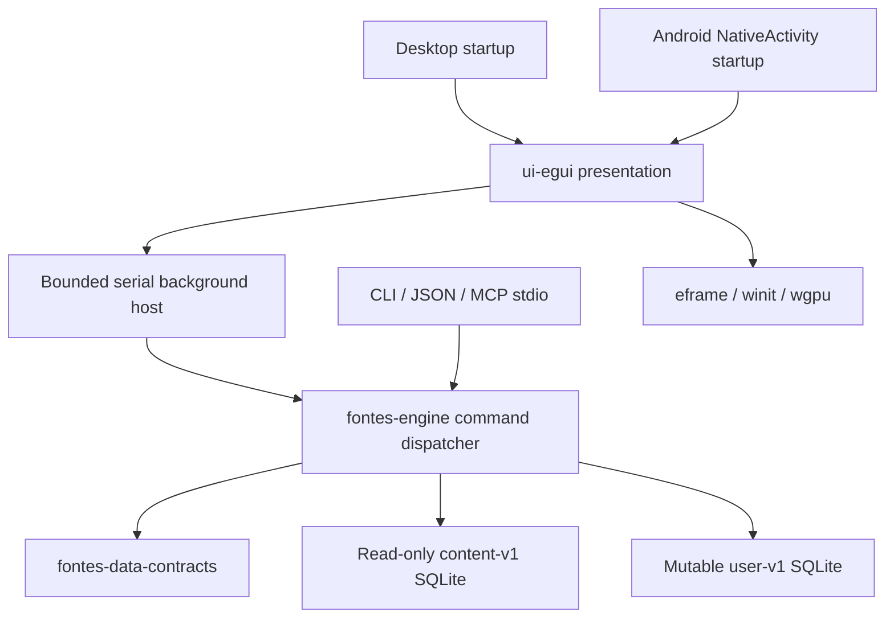

# Engine-first application architecture

Current direction (D041): Rust engine with a React/HeroUI presentation in Tauri 2. See [migration implementation and verification](tauri-migration.md). The following egui architecture remains the retained legacy frontend; its statements about no JavaScript/WebView describe that frontend, not the Tauri replacement.

Legacy direction: Rust application logic, egui on eframe/winit, wgpu rendering, and a replaceable UI. The [PhotoCraft architecture reference](https://raw.githubusercontent.com/storytold/photocraft/main/docs/architecture.md) informed the command/layer boundary; Fontes implements its own Scripture/reference behavior against its existing data contracts. The [eframe 0.35 API](https://docs.rs/eframe/0.35.0/eframe/) documents the selected native startup/rendering integration.

## Layers and ownership

| Crate | Responsibility | Dependency rule |
| --- | --- | --- |
| `fontes-data-contracts` | Existing permanent registry and versioned schemas/manifests | No toolkit |
| `fontes-engine` | Verified bootstrap service, stable typed commands, query/view models, parsing, local state, transactional notes, stdio adapters and serial worker | Never depends on egui, eframe, winit, wgpu, app startup or publisher/compiler crates |
| `fontes-ui-egui` (`crates/ui-egui`) | Token/font/icon integration, responsive panels, transient navigation/editor drafts, command dispatch and reply presentation | No SQL, corpus fetching/import, release signing or domain linking logic |
| `fontes` | Desktop arguments, platform data directory, explicit wgpu startup | Thin executable edge |
| `fontes-cli` | CLI arguments and stdout/stdin transport selection | No UI dependencies |
| `fontes-android` | NativeActivity entry, logging, private storage path and eframe startup | Same engine/UI; Android-specific code stays here |

The application's authored logic is Rust. Bundled SQLite and runtime zstd remain native C dependencies to preserve the published SQLite/FTS5 contract; graphics/windowing/platform bindings also call OS APIs. SWORD C++ and publisher `xmllint` remain **build-time data tools**, never app runtime dependencies. There is no application JavaScript/webview, app-authored Java/Kotlin layer, embedded Python interpreter or cloud model.

eframe/egui are pinned to **0.35.0**, the latest checked series compatible with workspace Rust 1.93 (0.36/0.37 require 1.95). wgpu is brought in through eframe's selected renderer/features; the core does not expose GPU handles. Metal/Vulkan/DX12 backend choice belongs to wgpu and platform support. WebGPU is a future possible target, not an implemented browser app; the SQLite engine has not been ported to wasm. The glow feature is not selected, although optional packages may still appear in Cargo.lock.

## Commands and concurrency

`Command` is an adjacent-tagged Serde enum using stable dotted IDs and strict argument types. `Engine::dispatch` is the common implementation for all frontends. Schemars generates each command's argument schema from that enum; [commands-v1.json](../../specs/app/commands-v1.json) is checked against the generated registry. Stable IDs must not be repurposed. Add compatible commands/optional parameters deliberately; incompatible changes need a new protocol contract and migration guidance.

The native UI uses the toolkit-independent `worker` host: one engine/SQLite owner thread, a bounded queue of 32 requests and serialized replies. The UI does not perform a database query per rendered frame. Each successful command returns a serializable workspace view model plus an operation-specific result. Worker completion requests a repaint through a frontend-supplied callback; the engine has no knowledge of egui. Failed commands retain the displayed passage and show a recoverable error. Window closure waits for already queued work; unsaved editor text is still a transient draft and is not an autosaved note.

Opening a local database and choosing its platform storage directory are bootstrap/platform operations. In-widget drafts, focus, scroll positions, panel destinations and clipboard delivery are presentation state. They do not duplicate durable Scripture, annotation or linking algorithms. Opening a replacement local snapshot retains the current engine if validation fails. A successful open is remembered through a small platform path-preference file.

The first command response includes the whole annotation list and saved references. This is practical for initial libraries but is not a demonstrated large-note-library budget; incremental/paged note view models and background cancellation remain future work. Multiple processes can share the user database with SQLite's locking/busy timeout, but their reading sessions are independent and last-writer-wins when explicitly saved. They do not subscribe to each other's transient navigation. A future live GUI control channel must route through the same engine host rather than implement another dispatcher.

## Storage boundary and compatibility

Content opens with SQLite read-only flags, `query_only`, disabled trusted schema and foreign keys enabled; extensions are not loaded. The engine checks Fontes application/schema IDs, build registry version, and every canonical ID against the embedded 31,102-anchor registry. It does not initialize user storage if the content registry is wrong. These checks are not cryptographic authentication or a replacement for full data-compiler validation.

The mutable user store uses the existing user-v1 SQL and seeds its own canonical registry from embedded trusted data. An unrelated or unsupported existing database is refused. Every note/highlight or favorite change uses a SQLite transaction and foreign keys; failed validation cannot leave a half-created annotation/range. Updates preserve note IDs and creation timestamps. Session/recent writes commit before the in-memory session changes. Query-only operations do not rewrite the session. Content and user files cannot be the same canonical path, and content is never replaced by app commands.

An additive app-owned `fontes_app_session_v1(singleton INTEGER PRIMARY KEY CHECK(singleton=1), json TEXT NOT NULL) STRICT` table stores selection, translation and bounded reading preferences. It does **not** change published user-v1 `user_version`, repurpose its tables, migrate content, or claim to be the planned library-v2 schema. Session JSON has a strict typed shape. A missing translation falls back to an installed one while retaining canonical location; invalid stored preferences/reference or a mismatched registry fails with a diagnostic.

This v1 bridge is temporary and read-only on the content side. Do not add downloadable works by mutating the snapshot. The future library-v2 repository/installer will sit behind the engine boundary and preserve existing canonical annotation IDs. Independent packages, composed generations, receipt/trust state, permission checks and recovery must be implemented before catalog installs or automatic updates are offered. The first-run bootstrap service downloads only user-confirmed signed v1 profiles; see [setup architecture](first-run-setup.md). Manually supplied paths remain explicit trusted-local imports, without verified-install claims.

## Query and evidence rules

- Scripture joins through source segments; one text segment is rendered once even if several canonical anchors map to it. Empty supplied text and omitted rows stay explicit; neither is filled from another edition.
- Search converts whitespace-delimited user terms to quoted literal FTS5 terms joined with AND. SQL is parameterized; there is no arbitrary SQL or executable FTS query command. Verse hits use the active translation; resource hits retain article identity. Pagination is bounded.
- Verse context returns article identity, author/type, typed linking basis and excerpt. `applies_to`, citation and `cross_reference` are preserved, with directly applicable resources ordered first, then narrower canonical coverage; no topic inference is relabeled as a citation. Articles retain source and rights-review IDs. The v1 UI opens source articles, not nonexistent paragraph-v2 anchors.
- Workspace verses expose additive `word_links` from existing content-v1 `word_alignments`, measured as zero-based, end-exclusive Unicode scalar offsets against the exact verse text. Only source/reviewed links with compatible canonical source-token references are returned; invalid spans fail. Alternative analyses are deduplicated per link/code. Translation/content changes invalidate presentation selections and their native widget state. KJV/WEB still have no original-token alignments. The new Study build separately supplies edition-bound KJV `strongs_links` for dictionary lookup, validated by exact text hash, source, dictionary code and scalar bounds. These do not assert a Hebrew/Greek token identity. WEB has no KJV dictionary tags.
- Original Greek results retain witness, position, analysis index, supplied lemma/morphology and each Strong's association. Dictionary headwords do not become invented lemmas. Verse-level tokens do not imply English word alignment. Occurrences deduplicate canonical verses across alternative analyses/witnesses. A zero count means no matches in installed token data, not a universal linguistic assertion.
- `study.word` exposes structured dictionary headwords/transliterations with their resource IDs. The UI promotes the exact chosen verse form, a verified selection-linked surface, or the dictionary headword to a 40 px original-language heading. Dictionary forms and verse forms remain separately labeled. Source-word focus is transient and clears on navigation, content or translation changes; a shared Strong's code never establishes an English alignment.
- User annotations remain canonical across translations/content snapshots. Optional package/block migration still awaits the library-v2 implementation. No generated theology, genealogy facts, book overviews, or AI explanation is substituted for unavailable datasets.

## Platform and release gates

Desktop builds share one entry point and responsive UI. Android shares the same UI/engine through NativeActivity and app-private storage; no external-storage permission is requested. The initial package is arm64, minimum API 28 and target API 35, with debug signing. NativeActivity is selected for the Rust-first development path. eframe 0.35 only supports Android AccessKit with GameActivity; a validated GameActivity bridge or another deliberate accessibility solution is required before claiming Android screen-reader support. Text input/IME, safe areas, pause/resume/process death and physical-device GPU behavior require tests.

The Android adapter reads `WindowInsets` on the Java UI thread using Rust JNI, with system bars/display cutouts on API 30+ and stable bar/cutout getters on API 28–29. Samples are matched against the current native surface size before converting to egui points at the current native density × UI zoom. Per-edge maxima merge these with NativeActivity content bounds, without adding the same inset twice. Empty/stale geometry is ignored. winit 0.30 drops `ContentRectChanged`, so an idle refresh runs every 250 ms with at most one pending UI-thread query. The shared UI creates its root scope inside `Context::content_rect()` and clips there, since eframe 0.35 supplies a whole-viewport root. Overlay and panel coordinates remain in the same space; no pointer offset or fixed status-bar padding is introduced.

[Android’s edge-to-edge guidance](https://developer.android.com/develop/ui/views/layout/edge-to-edge) explains system-bar/cutout insets for API 35 targets. An API 36 NativeActivity probe confirmed that native content bounds alone span the full window while WindowInsets reports actual bar margins. See [safe-area verification](verification.md#android-system-safe-area--2026-10-16). This bridge changes presentation/platform adaptation only; content, user storage, permissions and the engine command contract are unchanged.

Signed resource installation remains a separate milestone. Development archives and a macOS app bundle are packaged by CI and published as test prereleases. Production installers, Windows/macOS signing/notarization, Android production keys/store requirements, full installer recovery, user-data export/backup UI, full Hebrew RTL/shaping, accessibility/keyboard audits, and local AI are not completed by compiling this foundation. Android is the first mobile target; iOS work is deferred explicitly.

## Contextual desktop study

Desktop Study uses the reader plus a resizable companion panel, rather than replacing the passage. Study actions preserve the canonical reading selection and keep it visible when the panel changes the reading width. Native read-only text buffers provide drag/double-click selection and copying. A context menu resolves overlapping explicit word links; without a link it offers a clearly identified verse-level source-word chooser. A source word opens the same `study.word` engine command used by the CLI/MCP. No dictionary-definition matching, English-to-Greek position matching, or repeated-code heuristics create links.

Words, Commentary, Cross-references and Topics are presentation filters over typed engine results. Direct coverage is the default for commentary; citations elsewhere are opt-in. Display titles and match-basis labels are human-readable, while permanent resource IDs remain command targets. Source analyses are grouped by witness and token position; alternative analyses retain their supplied details. Article text, provenance and scripture links remain available in the same panel. Article queries remain bounded to 100 matches, with a notice at that limit. The panel deduplicates article identity within each section.

Cross-reference targets are an additive context view model, deduplicated by canonical range and bounded to 100. They come only from `cross_reference` links on directly applicable cross-reference articles, with narrower source coverage first. Previews use actual text at the range's first anchor in the active edition; unavailable text stays absent. Translation changes refresh these previews. Source article IDs and full range endpoints remain attached; the UI jump currently selects the first verse. No paragraph-native linking or article text rewriting is implied by these view models.

### Plain article typography and legacy Matthew Henry text

The current SWORD import retains plain paragraph/line boundaries, not rich inline typography. Render those boundaries as separate selectable paragraphs with 16 px UI-body text, 25 px line height and 12 px spacing, bounded to available width and at most 640 px. Do not create headings or sentence breaks from Roman numerals or punctuation. Native article scroll identities are separate from results/other articles, so opening starts at the article beginning and Back restores the results position. Rich inline emphasis, typed source headings and inline scripture anchors remain structured-import work.

The locked MHC source contains doubly escaped numeric references such as `&amp;#224;`. After normal markup decoding/stripping, the compiler repairs one additional numeric-only layer for this source, so new article/search text contains `à`. New imports record `text_normalization: mhc-numeric-v1` in the existing display metadata. The engine applies the same repair to full MHC article view models from older databases only when that marker is absent, so normalized content never receives a second repair. Other sources, named references, malformed/out-of-range references and additional nesting remain unchanged. Resulting angle brackets are literal text, never parsed as markup. Existing signed SQLite/source bytes, IDs and schemas remain unchanged; the normal compiler-commit identity gives future builds a new content ID. The shared Rust helper lives in `fontes-data-contracts`, avoiding a runtime dependency on the data compiler.

## First-run bootstrap

The owner-requested chooser and confirmed download replace the initial path prompt. `fontes-engine::bootstrap` owns signed snapshot discovery, bounded HTTP/decompression, validation, app-owned versioned receipts/replay state and staged activation. The GUI and CLI call the same service; no compiler or UI/GPU dependency enters it. Managed Open performs offline verification on the existing engine worker before exposing a user database. Android needs INTERNET only, without broad file permissions. See [first-run setup](first-run-setup.md) for exact lifecycle, bounds, compatibility and test evidence. This does not implement the future package-native installer, automatic updates or the bundled offline seed.

## Paper-and-sea-glass presentation refresh

D032 revises the UI default without changing the engine or stored session shape. Semantic palette and annotation highlight tokens are embedded from `assets/ui/assets.rs` and kept consistent with `tokens.json` and the asset generator. The selected navigation icon uses a mint pill; control/sheet surfaces share the light visual style. Mobile reading settings is transient modal state over the current destination. Its typeface, size, spacing and verse-number changes dispatch the existing `Preferences` command and use the same controls as desktop settings. Library actions remain on the full settings destination. Theme selection is not implemented.

The Android adapter requests light system-bar backgrounds/dark foregrounds on the Java UI thread: API 30+ uses WindowInsetsController appearance masks; API 28–29 preserves unrelated legacy visibility flags. Pre-35 bar colors and the shared viewport clear color use the same embedded page token; target-35 edge-to-edge bars show that clear color outside the safe UI. Compilation does not establish physical-device bar appearance or accessibility conformance.

The D033 toolbar refinement uses a full-width shared surface and a scoped transparent resting style, with common hover/press/open treatment. It reserves space for translation and icon controls before constraining the reference label. This changes layout only; the existing picker, translation, favorite and settings commands/flows are retained.

## Theme ownership and compatibility

The engine owns the serializable `ReadingTheme` key in `Preferences`; the UI owns colors in the embedded `assets/ui/themes.json` catalog. Immutable palette definitions are shared, while the active key lives in each egui Context, avoiding mutable global colors and cross-window interference. All destinations use semantic roles. Android polls the context's chrome color and light/dark appearance and reapplies system-bar foreground flags when the choice changes. The window clear color matches the chrome in safe areas.

The existing `preferences.set` command and app-session JSON persist the key. Missing keys default to Sea glass; unknown enum values are errors. No content or user SQL contract changes. Strict older app binaries may reject newly saved sessions with this additive field; downgrade compatibility for app-session JSON is not guaranteed. Independent user notes/highlights and canonical anchors are preserved. Saved annotation color names stay `amber`, `sage`, `blue`, `rose`, with readable light/dark rendering chosen by the active palette.

The D037 mockup composition uses native mesh gradients and reusable card/sheet treatments. Each rounded gradient uses a bounded 37-vertex fan, with no blur textures or network assets. Actual source fields remain separate within the word feature card; rendering never synthesizes glosses or original-language alignment. The root UI refreshes its style from the context so eframe startup styling cannot leave the default palette partially applied.

## Reference fidelity (D038)

The native presentation follows the owner-approved HTML geometry rather than relying on toolkit defaults: explicit font line heights/tracking, compact noninteractive metadata rows, rounded radial grids, tinted shadows painted behind fills, pill/code details and full-sized mobile hit areas. Existing data titles/excerpts remain authoritative; demo glosses and topic summaries are not substituted.

Word-action previews use the same bounded serial worker and `study.word` command, with FIFO UI-local reply purposes. Preview headwords are cached within a bounded session cache and never replace an existing word or article result. A single tap resolves only the supplied scalar span of the exact displayed edition; it does not infer a link from spelling.

Backdrop blur requests one clean frame through eframe/wgpu's application-frame readback, downscales to at most 512 pixels per dimension and runs three bounded blur passes on a background thread. Input is capped at 16 million pixels. Only the app frame is involved; no OS desktop capture, storage or transmission. Stale replies are generation-tagged and ignored; closing a sheet releases the texture/result receiver. Resizing recaptures; a palette switch discards stale-colored blur. Unsupported readback leaves an interactive tinted scrim. Native Metal readback is observed separately from injected readback events in the egui harness; Android runtime validation remains separate.

Rich highlights add the [documented app-owned v1 extension](../../specs/app/highlights-v1.md) without altering published user/content SQL. `highlight.save` validates typed styles, exact scalar offsets/quotes, edition membership and contiguous span coverage before an atomic annotation/extension transaction. Legacy `annotation.save` remains supported. The UI renders styles on text rather than reinstating the removed selection card; free selection has an explicit handle-edit mode, and normal text taps/swipes retain their separate word-study/scroll behavior.

Occurrence exploration uses additive `study.occurrences`: full distinct canonical verse aggregation is independent of page/filter, unlike the retained legacy `study.word` first-100 sample. Counts deduplicate source analyses and witnesses and describe installed original-token associations. Active-edition previews may be absent; they are not fabricated. Native rendering uses five proportional book bars and six-result pages; reading navigation retains a transient return context. No SQL or content migration is required.

## Bundled book openings

Reader book headings open Covenant Forms artwork and public-domain Henry introductions. The reference picker also exposes About [book], so access does not require scrolling to the chapter heading. Back preserves the reading reference; Start reading uses the existing Select command at book 1:1; Choose a chapter opens the existing staged picker. No SQL or engine command contract changes. Static data and SVGs are bundled under assets/ui/book-covers; provenance, continuator credits and extraction boundaries are documented there. This does not implement the separate structured book-overview database requirement.

## Approved Notes flows

The native notebook and scrapbook editor implement the Notes, selection-note and scrapbook prototypes. Durable document/source validation is engine-owned; egui never queries SQLite. The new app extension and 17-command catalog preserve published user-v1 and annotation fallback compatibility. See [notes v1](../../specs/app/notes-v1.md) for source retention, selection behavior, limits and remaining verification boundaries.
