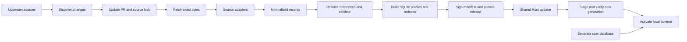

# Fontes data pipeline and offline update design

Use a Rust compiler running in GitHub Actions to turn locked source files into versioned, immutable SQLite databases. Publish compressed databases and a signed manifest as GitHub Release assets. Desktop and mobile share a Rust updater that installs each database beside the active version, verifies it, and switches a small local pointer. User notes and highlights live in a separate database throughout.

This preserves the reference-centric model in Specification v0.1 while making source refreshes, reproducible builds, app compatibility, and interrupted updates explicit. The initial transport is a complete snapshot for a selected content profile. Source imports are modular inside the build; clients do not need to merge resource databases or apply SQL patches.

The reading compiler, source acquisition, Ed25519 signer, GitHub publisher, package verifier, and release workflow are now implemented alongside the canonical registry, SQLite schemas, eight locked inputs, and shared contracts. The workflow compiles both reading and study twice and verifies reproducibility before publication. Study imports Strong’s Greek/Hebrew, both Robinson TR reading streams, Matthew Henry, Nave’s, and TSK. Scheduled source discovery and client installation remain implementation work.

## End to end flow



Upstream discovery and release compilation are different operations. Discovery may observe moving URLs and new commits; compilation consumes only the reviewed lockfile. An upstream outage, new license statement, parser regression, or deleted verse must not silently change a published dataset.

## Repository and component boundaries

| Component | Responsibility | Status |
| --- | --- | --- |
| `data/canonical/registry-v1.json` | Permanent book IDs and complete initial verse anchor catalog | Added and checked |
| `data/sources.lock.json` | Exact source bytes, sizes, adapters, and rights review references | Eight inspected inputs added |
| `data/profiles.json` | Required source membership and advertised capabilities | Reading and study profiles defined |
| `data/schema/` | Immutable content and separate mutable user schemas | Added and exercised in SQLite |
| `crates/fontes-data-contracts` | Shared identities, manifest types, structural checks, embedded schemas | Added with tests |
| `crates/fontes-data-pipeline` | Fetch, normalize, assemble, validate, compare, sign, and publish reading and study data | Implemented for both profiles |
| Future `crates/fontes-data-update` | Manifest verification, compatibility, download, staging, activation, recovery | To implement; shared by desktop and mobile |
| Future `data/curated/` | Reviewed genealogies, overviews, and reference mapping exceptions | To author |
| `.github/workflows/data-contracts.yml` | Run the existing contract tests, formatting, and Clippy | Added |
| `.github/workflows/data-release.yml` | Build reading and study twice and publish checked signed releases | Implemented |

Rust remains the application and pipeline language. A pinned SWORD utility toolchain can run in the build container as an ingestion dependency; published app data has no SWORD runtime requirement. Cache raw files outside Git under their SHA-256. Keep bulk datasets and generated SQLite files out of repository history.

## Identities and schema changes

### Canonical references

Book IDs are permanently allocated in the committed registry; they do not come from source file order or a localized book list. The initial registry has 66 books, 1,189 chapters, and 31,102 atomic verse anchors. The ID recipe is:

```text
canonical_ref_id = book_id * 1_000_000 + chapter * 1_000 + verse
John 3:16       = 43_003_016
```

The recipe reserves values 1–999 for each component. Validate actual chapter and verse existence against the registry as well as validating numeric bounds. Never rebuild the anchor registry from the current translation during a source refresh. Correcting a translation does not delete its canonical anchors. A future canon adds permanently allocated book identities through a versioned registry extension; changing existing identities requires an explicit migration and aliases.

`canonical_refs` represents atomic verses. `reference_ranges` stores inclusive start/end anchors, including ranges spanning chapters or books in the initial registry. This also avoids the draft's nullable `verse_end` uniqueness issue. The generated `canonical_refs` schema checks the ID recipe and has a non-null unique `(book_id, chapter, verse)` key.

### Translation and original language editions

Add `text_witnesses`, `source_segments`, and `segment_refs`. A witness identifies an edition and versification; a source segment retains the original reference and record key. The mapping table permits a source verse to cover multiple canonical verses or multiple source segments to cover one anchor. Reading queries use `verses_by_reference`; range queries deduplicate source segment IDs so merged text is displayed once.

This replaces the draft's assumption that every source verse maps one-to-one to one canonical reference. Original tokens belong to a witness and source segment, preserving token order. Alternative parses are separate `token_analyses` rows, with many-to-many Strong's associations. Morphology carries its coding system. A dictionary headword is not automatically a supplied lemma, and a missing lemma stays absent.

IDs for translations and resources are namespaced source identities, such as `translation:kjv` and `strongs-greek:G3056`. A resource's stable source record key survives content corrections. IDs for persons come from a curated identity registry or a stable upstream entity ID, never the person's name alone. Token IDs include witness, segment, and source token identity or position; applications must not treat positional token IDs as permanent annotation anchors across text corrections.

### Resources and editorial content

Preserve the spec's resources, resource links, persons, genealogies, overviews, and word alignment concepts. The content SQL adds provenance and permits resource links to scripture ranges, Strong's codes, or lemmas. Foreign keys validate links within each snapshot.

Genealogy relationships have multiple evidence ranges, and parentage is distinct from ancestry or legal parentage. Every published edge needs evidence, with cycle checks and identity review. Book overviews retain nullable author/date/audience fields, reviewed summaries, and links to source articles. Historical authorship and dating claims remain attributed claims. The build cannot fill missing fields by inventing content.

Word alignment offsets are **zero-based Unicode scalar positions with an exclusive end**, measured against the exact normalized `verse_texts.text` string. Source markup offsets must be converted during import. Only source-provided or reviewed alignments are published; repeated Strong's numbers cannot establish alignment by themselves. Validate every span and ensure its tokens and verse text cover compatible canonical references.

### Separate user storage

`user.sqlite` owns annotations, saved references, and update high-water marks. It contains a local copy of the permanent canonical anchor catalog, so annotation foreign keys remain valid independently of whichever content snapshot is installed. This is necessary because [SQLite foreign keys cannot cross attached database boundaries](https://www.sqlite.org/foreignkeys.html#fk_unsupported).

At first install, seed that local registry from the bundled trusted registry. Later verify identity equality before appending registry additions. Published content cannot alter existing user anchors. User database migrations ship with app versions, run transactionally with a backup, and are independent of content updates. A word-specific note also stores its quoted text, translation, and old content ID; if its word anchor drifts, retain the scripture-range note and flag its optional word attachment for review.

## Source ingestion and refreshes

### Source registry and lockfile

The research manifest is a candidate catalog, not a production allowlist. The production lock records source ID, acquisition URL, exact SHA-256 and byte length, adapter version, upstream revision if applicable, rights class, and rights review ID/evidence URL. The current eight locked inputs correspond to previously inspected downloads. The full Robinson TR archive still needs a lock entry; a checked John sample is not a full-corpus acquisition.

A separate source discovery configuration will describe the upstream branch/release or moving file, rights evidence URL, refresh cadence, expected coverage, and whether the source is enabled. For Git-hosted texts discover a commit and pin it. For moving download URLs compare actual hashes, using HTTP validators to reduce transfers. ETag, Last-Modified, and upstream version labels are hints; SHA-256 identifies the bytes.

A proposed weekly discovery workflow creates or updates one source-refresh PR containing the lock changes, upstream revisions, rights statement differences, and a semantic content diff. Repeated discoveries of the same bytes do nothing. The normal PR review records mapping exceptions or rights decisions. A changed or missing rights statement blocks that source until classified. Conditional tagged KJV and Berean annotations, CC BY morphology, and share-alike genealogies remain disabled under the current content policy.

Retain each accepted raw source in content-addressed storage and include an exact-source archive or immutable source assets with its release where redistribution permits. Future builds retrieve by digest from that retained copy before trying a moving upstream URL. This prevents an upstream replacement from making old builds impossible to reproduce. CI caches accelerate acquisition but are not the only archival copy. Keep evidence-page snapshots/digests for rights review separately from redistributable source content.

### Adapter contracts

Each adapter accepts verified source paths and a versioned configuration, then writes deterministic UTF-8 JSONL records and an import report. Acquisition is separate; adapters write normalized records and transactionally populate the content database. They do not query the network, infer missing genealogies, or fetch unapproved secondary sources. Parsing and normalized-record versions are part of the build identity.

| Input | Adapter output | Essential checks |
| --- | --- | --- |
| eBible verse XML | Witnesses, source segments, verse text, canonical mappings | Full required book coverage, unique references, source-to-canon mapping |
| Approved USFM layers | Display blocks, poetry, notes, supplied words | Text equivalence, preserved structure, annotation rights scope |
| Strong's Greek XML | Resources, code links, headwords and cross-references | All 5,624 expected entries; mixed XML content and valid targets |
| Specific Hebrew Strong's OSIS | Resources and Hebrew/Aramaic dictionary links | All 8,674 entries; exclude modern external article prose |
| Robinson TR text | Witnesses, tokens, supplied analyses and Strong's links | Complete NT, Greek decoding, wrapped records, alternative parses |
| MHC and TSK SWORD modules | Passage-linked resources | Enumerate all verse keys including aliases and linked ranges |
| Nave, Easton, ISBE SWORD modules | Topic/dictionary resources and reference links | Preserve entry aliases and all scripture references |
| Tidwell and other historical introductions | Editorial source articles | Deterministic section extraction; reviewed structured overviews remain separate |
| Curated JSONL | Persons, evidenced relationships, reviewed overviews | Stable IDs, no invented fields, evidence, editorial provenance |

SWORD exports require special care: a simple `mod2imp` dump may omit linked entries, as [CrossWire documents](https://wiki.crosswire.org/DevTools:Modules). The adapter must resolve every key against its content entry, then deduplicate article text while retaining the complete key-to-resource mapping. Tests must include a commentary spanning multiple verses and a dictionary alias.

Extraction is bounded by file count and total bytes. XML parsers do not load external entities; archive paths cannot escape the extraction root. Retain source text faithfully; search normalization is a separate field. Render only a supported structured text/block vocabulary. Keep all adapter diagnostics and rejected records in a machine-readable report, and fail required coverage mappings. Known upstream citation defects are retained in article text and an explicit, digest-bound diagnostic baseline (`data/mappings/study-v1.json`); a changed baseline fails compilation. Valid targets in partially malformed citation lists remain linked.

## Compilation and validation

The compiler processes each approved source into reusable intermediate outputs. It then assembles each complete profile in dependency order, using fixed insertion order and a pinned SQLite/toolchain/container. Build the database from scratch for every release; do not mutate the preceding published database.

Compute `content_id` from exact lockfile bytes, selected profile membership, canonical registry digest, curated input and mapping digests, adapter versions, schema, index configuration, and compiler/toolchain identity. Release sequence and publication timestamps are outside this identity. Canonically order records and JSON, omit volatile build timestamps from SQLite, build FTS in fixed document order, checkpoint/close journals, and compact before compression. Two builds of the same inputs in the pinned Linux environment must have identical SQLite and compressed hashes. Cross-platform byte reproducibility is not assumed.

Release gates include:

1. Every required source is locked, classified, fetched at its expected digest, and handled by an implemented adapter. Missing sources fail that profile.
2. All anchors match the permanent registry. No unmapped required segments, duplicate source identities, dangling links, cross-witness mismatches, or invalid word spans.
3. Expected source coverage and counts, `PRAGMA integrity_check`, `foreign_key_check`, and FTS consistency pass. Relationship evidence/cycle checks and overview review status pass.
4. A diff against the previous compatible profile reports added, changed, and removed records by stable ID. Unexpected book/verse loss or major count changes stop publication until recorded exceptions are reviewed.
5. Passage, word-study, reference-link, and retrieval smoke queries return actual evidence. Measure representative query latency and artifact sizes separately for each profile; enforce limits once baseline measurements exist.
6. The release verifier authenticates signatures, rejects changed artifact bytes, bounds decompression, and validates the actual SQLite output. Before shipping the app updater, add installation interruption/recovery tests against real signed packages and existing user annotations.

FTS5 is built into the SQLite profiles. Search hits retain verse/resource identities so RAG citations resolve back to real stored text. Embeddings and local models are separate, optional derived artifacts keyed by content ID, document identity, model/tokenizer revision, dimensions, metric, and preprocessing digest. Do not reuse a vector index across content revisions without verifying those bindings. They are outside the initial v1 manifest and need a versioned contract when implemented.

## Profiles and versioning

The initial `reading` profile contains KJV and WEB; `study` adds both dictionaries, Greek TR parsing, Matthew Henry, Nave, and TSK. These use the same schema and canonical registry. Mobile can select reading to reduce storage, while either platform can select study. Genealogy, book overview, and Hebrew morphology capabilities are advertised only when their actual reviewed data is included. No placeholder data enables a capability.

The study profile remains blocked until its full TR source and all adapters exist. Optional larger historical dictionaries can become a later profile or a versioned extension. A profile upgrade downloads a complete replacement snapshot, preserving user data exactly as an ordinary content refresh does.

Keep the version axes separate:

| Version | Meaning |
| --- | --- |
| Upstream digest/revision | Which source bytes were used |
| Adapter version | How source bytes became normalized records |
| Canonical registry version | Permanent reference identity contract |
| Content schema version | Tables, indexes, and meaning understood by the app |
| Manifest/update protocol version | Discovery, verification, download, and installation contract |
| Content ID and SQLite hash | Logical build identity and exact installed bytes |
| Release sequence | Monotonic publication order within repository/channel/schema |
| App version | UI, user migrations, and supported content/update contracts |

Content corrections do not require an app release when the existing contracts still fit. A schema/protocol change requires a compatible app first; keep the previous supported release line available. The current Rust manifest parser deliberately rejects unknown fields and versions. New manifest fields require a negotiated version or an explicitly backward-compatible parser change, not an unannounced server addition.

## GitHub Actions and release publication

Use three workflows. `data-contracts` validates contracts and the reading pipeline. `data-release` builds from `main` after source/compiler changes or manual dispatch. Local `fontes-data build` creates checked outputs without signing or publication. The future `data-refresh` workflow will run weekly or manually and propose upstream changes; it has not been activated.

The release workflow has separate jobs:

| Job | Inputs and outputs | Permissions |
| --- | --- | --- |
| Plan and acquire | Lockfile, source archive/cache, selected profiles | Read repository; no signing key |
| Normalize | Verified files to versioned JSONL and adapter reports | No repository writes; offline adapter stage |
| Assemble and test | Profile databases, FTS, diffs, counts, reproducibility results | Read-only repository |
| Package | SQLite `.zst`, uncompressed hashes, source archive, notices, validation report | No signing key |
| Sign and publish | Checked same-run outputs to signed manifest and draft release | `contents: write`; narrowly scoped signing secret |
| Verify publication | Fetch published assets and verify sizes/digests/signature | Read-only |

Pin the container by image digest, Cargo dependencies with `Cargo.lock`, and Actions by reviewed commit SHAs. Publish only from a trusted default-branch checkout; never sign arbitrary pull-request artifacts. Keep signing credentials out of discovery, parsers, and external source tools. Serialize publication for a repository/schema/channel so two runs cannot allocate the same sequence. GitHub's [workflow security guidance](https://docs.github.com/en/actions/reference/security/secure-use) covers permission scoping and dependency pinning.

Allocate a sequence larger than every previously reserved sequence in that release line, including drafts. Use tags such as `data-v1-stable-42`, pointing at the exact compiler/configuration commit. If inputs have the same content identity as the current release, skip publication. A retry allocates a fresh sequence after a failed draft; a published tag is never overwritten. The initial publisher inspects up to 10,000 release records; increase or replace this discovery bound before reaching it.

Create a **draft** release, upload the complete asset set, download and verify it, then publish. Enable immutable releases for published data where available. Set `make_latest=false` so a data release does not replace an application release as the repository's latest release. GitHub supports [drafts, tag-linked assets, and the latest flag](https://docs.github.com/en/rest/releases/releases); its [release management guidance](https://docs.github.com/en/repositories/releasing-projects-on-github/managing-releases-in-a-repository) recommends attaching assets before publishing an immutable release.

Expected assets:

```text
release-manifest.json
release-manifest.json.sig
fontes-reading.sqlite.zst
fontes-study.sqlite.zst                 # only when the complete profile passes
sources.lock.json
source-kjv-base-<sha256>.zip            # exact input bytes
source-web-classic-<sha256>.zip         # exact input bytes
validation-report.json
changes.json
NOTICE.txt
```

The manifest contains the repository, tag, channel, sequence, builder commit, lock digest, schema/protocol/registry versions, signing key ID, sources, and each profile's capabilities, counts, content ID, compressed/uncompressed lengths, and both SHA-256 values. Names of required metadata assets are fixed by protocol. The detached Ed25519 signature covers the exact UTF-8 manifest bytes with a fixed `FONTES-DATA-MANIFEST-V1\n` domain prefix, where `\n` means one newline byte, `0A`; verify before parsing. The signature asset is exactly 64 raw signature bytes. Try only app-trusted public keys, then require the parsed signing key ID to match the key that verified. Expected repository, channel, trust keys, size limits, and supported versions come from app configuration, not the downloaded manifest. Raw-source archives and reports are for build audit, not app installation; a later signed audit asset listing can bind those files separately.

Rotate keys through an application update that trusts both the old and new public keys before switching the publisher to the new key. Retain old keys for verifying stored generations. Key removal or compromise response needs an app trust-policy update; an untrusted manifest cannot introduce its own replacement key. The initial protocol has no remote key-delegation mechanism.

A public app needs public release assets. The current repository is public. If that changes, publish to a public data repository and configure that repository identity in the app. Do not embed a GitHub access token in desktop or mobile binaries. The reading workflow and signing-secret setup are part of the first implementation; source-refresh automation and app installation remain separate work.

## Desktop and mobile update protocol

### Discovery and verification

Bundle a working reading database, the reference registry, and trusted manifest public keys with the application. Offline reading does not depend on an initial network request. Check for updates on user request and, when the app is running and online, at most daily by default with jitter. OS background execution is optional; Android/iOS can resume downloads when the application next runs. Respect metered-network and battery settings for large downloads.

Use the public GitHub Releases API with conditional requests, pagination, caching, backoff, and a descriptive User-Agent. Filter tags to the configured data schema/channel and fetch candidate manifests and signatures. Choose the highest compatible **verified sequence**, not the repository's latest app release or the lexical order of tags. Bound work per session and resume pagination later; retain the active dataset if discovery is incomplete. GitHub documents [public release listing and pagination](https://docs.github.com/en/rest/releases/releases#list-releases) and [unauthenticated API limits](https://docs.github.com/en/rest/using-the-rest-api/rate-limits-for-the-rest-api). Public API users behind the same IP share capacity; a cache/CDN for discovery metadata is a future scale option without changing signed database assets.

Reject repository/channel mismatch, unsupported protocol/schema/registry, unknown signing keys, malformed manifests, missing profile assets, duplicate entries, and hashes/lengths outside client limits. Persist the highest verified sequence per repository/channel/schema. Never accept a lower sequence as an automatic update. A local rollback is an explicit operation to a previously verified local snapshot; publishing a server-side rollback uses a new higher sequence referencing the known-good dataset. If the remote feed is stale or unavailable, continue using local content. Replay resistance does not prove the server is presenting the newest release to a first-time client.

### Stage and activate

Install content into the app's private writable data directory:

```text
user.sqlite
content/
  generations/<sqlite-sha256>/library.sqlite
  generations/<sqlite-sha256>/release-manifest.json
  generations/<sqlite-sha256>/release-manifest.json.sig
  downloads/<compressed-sha256>.part
  active.json
  previous.json
```

1. Take a single updater lock. Calculate required free space from signed lengths, compression retention, current/previous generations, and a safety margin. Never remove the only good dataset to make room.
2. Download the selected profile to `.part`. Resume only when the server confirms a matching object validator and a valid Content-Range; otherwise restart. A partial download never counts as installed.
3. Verify compressed length and SHA-256. Stream decompression to a staging generation with a hard cap on uncompressed length and verify the final SQLite hash. Downloaded content never executes a migration script.
4. Open the database read-only, with extension loading disabled and defensive/trusted-schema settings appropriate to the app. Verify application ID, user version, build metadata, registry identity, schema shape, integrity, foreign keys, counts, FTS, and smoke queries. Check it contains the selected profile and all required capabilities.
5. Close staging handles, flush the file and directory metadata using platform primitives, and move the completed generation to its final hash-named path on the same filesystem. Generations are never overwritten while open.
6. Under a short activation lock, preserve the old active pointer as `previous.json`, write and flush `active.json.tmp`, then replace the active pointer atomically using the platform's supported file-replacement operation. Readers capture an entire generation handle; new requests use the new generation, while in-flight readers finish on the old one.
7. On startup, verify the chosen generation and recover from incomplete staging or an invalid pointer using the previous verified generation or the bundled database. Never use an unverified directory as fallback.
8. Garbage-collect old generations only after all readers release them; retain at least one known-good previous generation. Close handles before deletion on Windows. Update the high-water mark without lowering it during recovery.

This avoids replacing an open SQLite file, relying on different multi-file transaction behavior, or assuming Unix rename behavior is identical on Windows and mobile. `user.sqlite` is not part of the content pointer transaction. Crashes before activation leave the old generation active; crashes after pointer replacement leave a complete new generation. Cancellation, HTTP failure, signature failure, insufficient disk, incompatibility, and validation failure all leave the existing content usable.

### App update and data update interaction

The app advertises supported content schema versions and canonical registries. An older app ignores incompatible new datasets and retains its compatible local version. An app upgrade can use a bundled new schema or download a compatible snapshot before switching; it does not migrate an immutable published database in place. Never delete content required by a still-running generation.

A shared updater library provides the same verification and recovery behavior on all platforms. Platform layers provide filesystem atomic replacement/flush operations, app-private paths, connectivity preferences, background scheduling, and download progress. Mobile packaging and store review affect executable updates, not the fundamental separation of scripture data from the app binary; platform policies still need checking when the mobile app is implemented.

## Initial delivery sequence

1. Implement fetch-by-digest and the eBible adapter; build the complete reading profile locally. Produce reproducible databases and a fixture-signed install test.
2. Implement both dictionary adapters and full Robinson TR acquisition/parsing, followed by SWORD key/link-preserving adapters. Build the study profile with honest capabilities.
3. Implement the shared installer, real signature verification, interruption/recovery tests, and app integration. Test Windows/macOS/Linux and mobile filesystem behavior.
4. Add discovery PRs, semantic regression reports, retained raw inputs, and the trusted signing/draft-release workflow. Configure the public destination and release key; enable production publication after the end-to-end gates pass.
5. Add reviewed genealogies/overviews and any newly classified source layers. Measure package sizes, update costs, and storage on mobile before introducing incremental transport.

When measurements justify deltas, add them as an optional future transport bound to exact base and target SQLite hashes. Apply a patch to a staging copy, perform the same full target validation, and fall back to the complete snapshot on any mismatch. Retain full snapshots for new installations and skipped releases. This keeps the permanent reference model and activation protocol intact.


## Implemented study import details

`tools/sword-export.cpp` uses SWORD 1.9.0 only for binary decoding, key enumeration, and ThML reference parsing. It disables skipping consecutive links, checks `hasEntry`, includes introductions, distinguishes testament headings, and numbers repeated dictionary keys. Article text is deduplicated while every commentary key retains an `applies_to` range. TSK entries retain their own reference context even when raw markup matches another verse. Its distinct `Jud`/`Jude` abbreviations are resolved before parsing. The Rust markup adapter preserves all prose, including preverse material that SWORD display filters can remove. Paragraphs are plain text with newline boundaries; source XML/ThML is never executable display content.

Robinson ASCII is converted to unaccented Greek with a checked alphabet. Triple-pipe variants produce separate first/second source reading witnesses. Both have complete canonical NT coverage. Alternative analyses keep their own morphology and Strong’s associations; zero markers and extra numeric parsing IDs remain in original ASCII apparatus. Subscriptions and alternate numbering are preserved there as well. No KJV alignment, lexeme lemma, or Hebrew token morphology is fabricated.

The initial study build has 14,298 Strong’s codes, 281,240 tokens, 281,307 analyses, 281,330 Strong’s associations, 15,914 Greek segments, and 64,090 resources. The citation audit retains 439 known source anomalies. These are corpus baseline counts, not guarantees about future source editions. The verifier checks source membership and profile capabilities, relational integrity, complete reading/Greek coverage, dictionary definition links, resource search coverage, and passage smoke queries. SQLite tables retain the v1 contracts; new/partial indexes are additive. The bounded verifier accepts at most 1 GiB SQLite and 256 MiB compressed per profile.

A release contains both complete profile artifacts and their union of eight source snapshots. The publisher refuses to remove an existing profile, verifies older signed manifests (including the original reading-only release), compares semantic verse/resource changes per profile, and verifies every artifact in draft and public downloads. Client activation remains future work; signed package verification is implemented.
