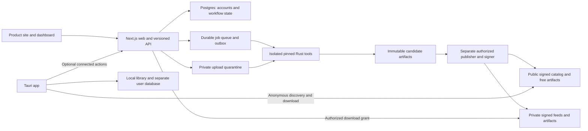

# Fontes server components and delivery plan

Status: **architecture baseline with a partial development implementation**, 2026-10-17. This document supports [SPEC.md](../../SPEC.md), decisions D047–D050 and D052–D054 and requirements FR26–FR32. The [Next.js dashboard scaffold](../../apps/fontes-site/README.md) now provides Postgres metadata CRUD/review/activity, a [draft HTTP API](../../specs/server-api/v1/README.md), managed Neon Auth integration and a guarded login-free local mode. The dedicated development database/auth service is provisioned. Source preparation is available in local development as described below. Hosted source intake/publication, private resource delivery, checkout, hosted AI and the product website remain planned. Broader entities/flows below are design targets, not implemented migrations or frozen contracts.

The owner directed rapid dashboard/API prototyping before phone integration. This first slice deliberately implements metadata review rather than claiming a complete S0/S1 publishing milestone. HeroUI's default control appearance is required; use built-in component variants and layout CSS instead of retheming colors, sizes, radii or states. Native auth, verified managed-session/recovery/MFA evidence and hosted isolated source intake remain gates.

D049 adds [local resource preparation](resource-preparation.md): preserve and validate offline source packages, or collect rights/artwork metadata and import a bounded prose EPUB into a readable draft. Explicit reference candidates require publisher decisions; exact-byte preparation approval precedes source export. Postgres retains conversion/proposal history. File processing is local-development-only; hosted isolated jobs/storage and trusted source publication remain open. Optional AI themes/allusions are planned, not simulated or invoked.

D054 adds [explicit source-package intake and independent maintainer review](maintainer-review.md), ending in an unsigned existing-format publication handoff for the trusted source-release workflow. Live policy changes, signing, CI dispatch and external release reconciliation are separate gates.

## 1. Product direction and scope

Fontes remains a free, offline-first study application. Servers add optional publishing, distribution, organization access and eventually paid services. Installed public-free resources, reading, search, study, notes and highlights must work without an account, valid session or available Fontes server. Initial resource acquisition still needs a connection under the current bootstrap; an offline seed remains a separate requirement.

The owner selected **public publisher submissions and maintainer review as the first server release**. Private organization publishing follows. Organizations will choose among supported offline-access policies; neither a universal permanent grant nor universal expiration is assumed. Paid licensed resources and hosted AI are later phases. Local AI remains a separate planned capability; the new paid AI direction does not introduce a charge or server dependency for ordinary local study.

Use one account system. A person can read, buy resources later, submit work, and belong to several organizations. “Publisher” describes an authorized publishing identity/capability, not a separate login class. Churches, schools, seminaries, commercial publishers and individual authors can use the same publishing path. A Fontes maintainer is a separately assigned platform role.

Keep these dimensions independent:

| Dimension | Examples and rule |
| --- | --- |
| Ownership | Individual publishing identity or organization; accountable owner of resource namespace and updates |
| Visibility/audience | Public listing, or organization-only listing and content; private metadata and covers are private too |
| Acquisition | Free public grant, organization membership grant, or later purchase/seat grant |
| Editorial status | Draft, pending review, changes requested, approved, withdrawn; private organization releases bypass Fontes editorial admission |
| Default inclusion | Separate Fontes-maintained bundle choice; public approval never automatically adds a work to the default collection |
| Permitted uses | Offline display, keyword search, export, print, embeddings and AI context remain resource-specific |
| Offline access | Retained downloaded copy or bounded offline lease, as supported and disclosed for the release |

An organization need not be “private” as an identity type. It may eventually publish both public resources and organization-only resources. Changing a private release to public requires explicit public submission and review; changing visibility never retroactively changes an installed grant or exposes an upload automatically.

## 2. Existing authorities and the missing delivery layer

Read these together before implementing the server:

| Authority | Reuse and boundary |
| --- | --- |
| [Authoring guide](../resource-publishing/authoring-guide.md), [CLI](../resource-publishing/cli-guide.md), [source schemas](../../specs/resource-packages/v1/README.md) | Authors upload the existing XML/assets source ZIP. Keep stable resource/block IDs, rights, artwork and concept rules. The server uses pinned Rust tools rather than a second TypeScript validator. |
| [Submission pipeline](../resource-publishing/submission-pipeline.md) | Implemented read-only validation, deterministic canonical source ZIP, hash-bound approvals and separately privileged signed source releases. Preserve its isolation and exact-byte approval model. |
| [Maintainer guide](../resource-publishing/maintainer-guide.md) | Public rights, publisher identity, editorial review, release ordering, corrections and withdrawal. |
| [Library/package design](../specifications/library-and-packages-v0.2.md), [client guide](../resource-publishing/developer-guide.md) | Planned signed compiled payloads and composed local library v2. Source releases are not app-installable resources. |
| [Catalog schema](../../specs/resource-packages/v1/catalog.schema.json) | Draft public-free catalog: `rights.distribution` is fixed to `public_free`. It cannot describe paid/private distribution by adding ad hoc fields. |
| [Publication policy](../../specs/resource-packages/v1/publication-policy.schema.json), [approval schema](../../specs/resource-packages/v1/approval.schema.json) | Implemented public-free/private-restricted source policy with exact-source approvals; the existing private repository guard is not an organization service or authorization bypass. |
| [Application migration](../app/tauri-migration.md), [bootstrap](../app/first-run-setup.md) | React/TypeScript, HeroUI 3 and Tauri/Rust are current app boundaries. Existing signed snapshot installation/update remains separate from add-on installation. |

The current app receives one complete default free-resource snapshot. Independent resource installation still needs the exchange schema, library v2 ownership/migration, anchor continuity, compiler, catalog and recovery work in P3–P5. A portal can accept/review source submissions before these gates close, but its status must say **approved source** or **source release available**, never “available in the app” without compiled delivery and verified installation.

The older package detail lists eight starter sources and Reading/Study selection bundles. D043–D046 supersede that delivery direction for current defaults: preserve all twelve current locked sources and the single complete free-resource selection when planning modular equivalents. Do not rebuild only the older eight-source example or reintroduce the removed setup choice. Existing signed bytes, canonical IDs and user-owned notes remain unchanged.

## 3. Recommended architecture

Start with **one Next.js/TypeScript application**, one Postgres database and object storage. Use modules inside that application rather than separately deployed services for accounts, publishing, organizations and commerce. Run resource validation/compilation as isolated background jobs using the existing Rust tools. This keeps frontend and server application code in TypeScript while retaining the established data authority.



| Component | Responsibility and initial deployment choice |
| --- | --- |
| Product site | Public Next.js pages for features, real screenshots, downloads, resource overview and publisher guidance. Mostly static/cacheable. |
| Dashboard | Same Next.js deployment: personal workspace, organization switcher later, resource uploads/status and separate maintainer review area. HeroUI 3 with Fontes typography, tokens and artwork. |
| API | Explicit versioned HTTP endpoints for native clients; web mutations call the same application services. Next.js Server Actions alone are not the app integration contract. |
| Postgres | Accounts/auth integration, resource ownership, review state, jobs, audit records and later memberships/grants/orders. Neon is the preferred initial database candidate. |
| Object storage | Source archives, private review evidence/previews and immutable compiled artifacts. Separate public and private storage policy; large books do not live in Postgres or pass through a web request for compilation. |
| Jobs | Postgres-backed durable jobs plus transactional outbox initially; bounded retries, worker leases and recovery after interruption. Add a separate queue product only if workload requires it. |
| Build runner | Pinned, sandboxed Rust validation/preparation, later compilation. No arbitrary publisher scripts, network XML includes or signing credentials. |
| Publisher/signer | Authorizes exact approved artifact hashes, signs and verifies releases, then advances discovery. Separate credentials and execution from parsing publisher input. |
| Email | Verification, recovery and invitations through a configured transactional provider. No email is sent by this planning change. |

Initially retain the existing GitHub pipeline for public source publication. The portal should create reviewable submissions and display verified results; it should not replace trusted repository policy with a row that any web administrator can edit. A narrowly scoped integration writes public submission data only after the contributor explicitly authorizes public disclosure. Maintainer approval still enters trusted policy/review. No private upload, agreement or unreviewed rights evidence goes into public Git, logs, artifacts or releases.

Object-storage transport for organization publishing requires a new reviewed backend and authorization contract. The current source publisher requires private repositories for `private_restricted`; it does not already support serving per-organization objects. Keep that guard intact while adding an explicit new path.

Architecture boundaries (the scaffold now exists in `apps/fontes-site`; the shared packages/worker are still future extraction points):

```text
apps/fontes-site/          # Next.js: product site, dashboard and API
packages/fontes-ui/        # shared visual tokens and reusable web components
packages/fontes-cloud/     # server-only domain services and authorization
packages/fontes-api/       # versioned HTTP schemas and generated client types
workers/fontes-resources/ # orchestration of pinned Rust tool invocations
```

The scaffold keeps server-only services and the draft API schemas inside `apps/fontes-site/src/lib` until extraction is useful. Shared UI code must not import Tauri IPC into the website or server secrets into the app bundle. The installed app continues using the Rust engine; Postgres is not its study database. No distributed cache, Kubernetes, hosted search cluster or always-running AI worker is required for the first slice.

## 4. Authentication selection and permissions

D048 selects **managed Neon Better Auth with Neon Postgres for the development prototype**, following the owner's request to enable Neon auth. This supersedes the initial recommendation to host Better Auth with Next.js. One managed identity authority is wired through the Neon SDK; local personas are explicitly synthetic development actors, not a second deployed identity service. Evaluate remaining managed-auth capabilities before production or native integration.

As checked on 2026-10-17, Neon's [managed auth overview](https://neon.com/docs/auth/overview) describes auth stored alongside application data. Its [roadmap](https://neon.com/docs/auth/roadmap) lists organization support as partial, MFA as forthcoming, and constraints on standalone frontend/backend deployments. Those are reasons to test the exact Fontes flows before choosing managed auth. Better Auth documents [organization membership and invitations](https://better-auth.com/docs/plugins/organization), [2FA](https://better-auth.com/docs/plugins/2fa) and an [OAuth provider with PKCE](https://better-auth.com/docs/plugins/oauth-provider); documentation is not proof that our Tauri integration works.

The remaining spike must demonstrate real email verification/recovery, invitation acceptance by new and existing users, scoped organization permissions, maintainer MFA, session revocation, account linking without email-based takeover, and native sign-in on desktop and Android. The current no-session proxy and production bypass checks do not close those gates. Revisit auth hosting if managed support cannot meet them; preserve stable Fontes account mapping if that changes. Exact scaffold dependency versions are pinned in its lockfile; migrations use the Neon driver directly. Self-hosted auth would require separate patching, email delivery and session/key operations.

Separate platform roles from organization roles:

| Actor/capability | Allowed actions |
| --- | --- |
| Anonymous reader | Use installed public-free library; browse/download public-free offerings without an account |
| Verified account | Manage own profile, create own publishing workspace, submit owned resources, accept invitations and later restore purchases |
| Organization member | Discover/download that organization's releases subject to grant/seat/offline policy |
| Organization publisher | Upload, version and publish private organization resources after automated checks; submit public releases for review |
| Organization administrator/owner | Manage member invitations/roles, resource policies and ownership; preserve at least one owner |
| Fontes reviewer | Review public submissions within assigned scope; record identity/rights/editorial decisions |
| Fontes release operator | Authorize publication/default-bundle changes within release policy; protected session and audited action |

Account signup does not verify a commercial publisher or reserve an arbitrary existing namespace. Allocate personal namespaces and organization namespaces through an ownership service; require verified authority for claimed publisher identities. Organizations and publishing identities have stable IDs separate from display names and slugs. Individual authors should not have to form a legal organization to submit a work.

Every request checks the authenticated actor, target ownership and permission at the service/data boundary. An “active organization” UI selection or a supplied `organization_id` is not authorization. Queries, object keys, job results, private covers and diagnostics all enforce scope. Use secure HTTP-only web sessions, mutation origin/CSRF protection, rate limits and audited role changes. Require MFA for maintainer release/role administration before production. Privileged support access to private content must be explicit and audited; ordinary public review access does not grant access to every organization's library.

## 5. Public publishing and review

1. **Create identity and draft.** Sign up, verify email and choose a publishing identity. Enter metadata or upload an existing source ZIP from `fontes-resource pack`. Link the schema/CLI guides; browser editing/conversion can follow later.
2. **Upload privately.** Issue a short-lived upload intent restricted to the actor, object, actual byte limit and allowed file type. Complete upload by measuring and hashing stored bytes. Quarantine all uploads; upload success is not publication or approval. Show a warning before the later deliberate public-submission step.
3. **Validate in isolation.** A worker runs pinned source validation/preparation and saves bounded diagnostics with the existing codes and XML locations. Distinguish the uploaded archive digest from the deterministic normalized source ZIP digest used for approval. Record toolchain, registry and policy versions.
4. **Review.** Freeze a source revision and show metadata, readable previews, separate text/artwork rights evidence, source fidelity, coverage, concepts and version diff. Publisher verification and namespace ownership are separate from package validity. Maintainers can request changes or reject with reasons. Any changed source invalidates its earlier approval.
5. **Approve exact bytes.** Bind approval to resource identity, source version, normalized source digest, distribution and rights/identity review records under the existing approval contract. A web review action requests trusted approval; an untrusted webhook or contributor flag cannot authorize signing.
6. **Prepare and publish.** Rebuild from frozen inputs in a fresh trusted job; compare reproducibility outputs and authorize the resulting inventory. The separate publisher verifies uploaded immutable assets before catalog publication. Retried jobs reuse only identical assets and reject identity/hash conflicts.
7. **Expose accurate availability.** First portal milestone may stop at signed source publication. After P3–P5, publish compiled delivery and catalog, install on a clean client and expose it in the app's optional library. Resource approval does not enroll it in the default bundle.

Keep editorial workflow separate from job state. Proposed editorial states are `draft → submitted → in_review → changes_requested | rejected | approved`, with an independent withdrawn record after publication. Jobs have `queued → running → succeeded | failed | cancelled`. Release records distinguish prepared, verified and published. An approved resource can have a failed compilation; that must not appear as a published release. Preserve revision history, reviewer identity and reasons; reopening a review creates a new event.

Withdrawal stops new distribution through a newer signed catalog/feed sequence and preserves evidence. It does not silently erase installed resources or notes. A signing compromise requires trust revocation, not merely hiding a listing.

## 6. Private organizations, invitations and app access

D050 now implements [organization management](organizations.md): scoped owner/admin/publisher/member roles, hashed single-use copyable invitation links, atomic acceptance, last-owner protection, policy-preference history and separate private metadata drafts. D052 adds local publishing-team EPUB evaluation with paged reading and retained source notices. D053 adds revisioned text/reference corrections, publisher content approval and subsequent validated source ZIP generation with retained hashes. No invitation email, approved ordinary-member preview, private source publication/feed/download grant, native membership refresh or offline enforcement is connected yet. The design targets below retain those remaining gates.


After the public portal foundation, add organization management and a **My organizations** area in the app. Creation, invitations, acceptance, catalog refresh, downloads and updates are connected actions. Reading a downloaded resource follows its disclosed offline grant. Local notes are never organization documents merely because they reference an organization resource.

**Invitation flow:** an owner/admin invites a specific email to a bounded role. Store a hash of an unpredictable, single-use, expiring invitation token; support resend/revoke and rate limits. Opening the HTTPS invitation shows the organization, inviter and role. The recipient signs in or creates an account, verifies the matching email and explicitly accepts. Consume the invitation and create membership atomically; handle duplicate acceptance, revoked invites, expired tokens and existing membership. Do not enroll someone merely because their address uses a school's domain. General share links, domain autojoin, class groups and SSO are later features.

An invitation joins an account to an organization; signing an app in attaches that same account to a device. They are different operations. Use the system browser for native authorization with an authorization-code/PKCE flow, validated state and exact registered callbacks; native clients carry no client secret. Tokens are exchanged through the native boundary and stored in OS-protected credential storage, not browser local storage or the notes database. The [native OAuth standard](https://www.rfc-editor.org/rfc/rfc8252) is the baseline. Determine Android verified app-link and desktop callback behavior in the spike; do not assume a Better Auth Electron integration applies to Tauri.

If the app is absent, acceptance completes on the website and offers a download/open-app step. If the app is installed, its authenticated membership refresh finds the organization; a deep link is a convenience, never a bearer membership grant. App sign-in must not change local canonical anchors or automatically upload notes. Sign-out clears connected credentials and account-specific online caches, returns the reader to usable local study, and applies only previously disclosed local access rules to restricted resources. Account switching must not expose another account's private feed or download grants.

**Private publishing flow:** an authorized organization publisher uploads a resource to its organization, attests distribution rights, chooses a supported offline policy and publishes after automated validation/compilation. Fontes editorial review is not required. Ownership, safe archives, reference integrity, rights declarations, quotas, malware/input limits and technical signing still apply. Organization concept proposals remain scoped; they do not silently modify the shared Fontes concept registry. Clearly label organization resources as supplied by that organization, without implying Fontes editorial approval.

The existing source-release approval contract still requires maintainer review records; private self-service publication needs an explicit new organization-authorization record/protocol. Do not fabricate a Fontes rights approval to satisfy the old schema. The publication worker must confirm a valid actor/organization authorization and current policy again before releasing an already queued private build, including membership removal or policy changes during the build.

The member feed, search, metadata, covers, previews, archives and payloads require authorized access. Use short-lived object download grants after a fresh server-side membership/entitlement check. Keep stable artifact digest/length in the signed release descriptor; expiring storage URLs are transport credentials issued separately, not permanent signed identities. No private releases in public catalog snapshots, sitemaps, CDN caches or public GitHub Actions artifacts. Signing proves artifact provenance, not a public right to fetch it.

### Supported offline policies

The owner chose **organization-selectable policies**. Build a bounded policy menu, not arbitrary organization-supplied license scripts. Proposed first policies:

| Policy | Device behavior | Membership removal |
| --- | --- | --- |
| Keep downloaded copies | A verified download carries a durable local reading grant; explicit permitted uses still apply | Deny new downloads/updates when the server learns of removal; existing copies remain usable |
| Renewable offline lease | A signed, account/resource-scoped license permits use through a disclosed expiration; renew online while eligible | Deny future renewals/downloads; a disconnected device can use its existing grant until expiration |

The policy and any lease duration must be shown in the dashboard and app **before** download. Use a finite supported duration range selected in the license design; do not invent a default duration here. Each installed grant binds resource/version, organization, beneficiary, policy revision and applicable permissions. Restrict later renewals without silently turning a previously durable download into an expiring one. New policies apply to new grants or explicitly accepted changes, subject to the promised terms.

Neither policy can promise immediate recall of bytes on a disconnected device. Clock rollback, copied plaintext and a modified client limit lease enforcement; the design must describe those limits without marketing it as guaranteed DRM. Encryption/device binding, if a future agreement requires it, needs a separate threat model and recovery design. Once a lease expires, keep the user's notes/anchors and explain unavailable source material; do not erase user-owned content. Exported excerpts cannot be remotely recalled either. Private publication must wait for a versioned policy/grant contract and actual device tests of restart, offline expiry, clock handling, sign-out and account changes.

## 7. Storefront, payments and resource entitlements

Plan commerce as an additional acquisition path to the same resource library. A purchase buys a defined resource/edition grant, not a new database schema. Prices, currency, seller, territory/platform eligibility, rights and offline terms must be presented before checkout. Crossway/ESV are examples of potential relationships, not approved suppliers, agreed prices or redistributable titles.

Recommended initial model to investigate: Fontes operates a curated storefront with individual one-time resource purchases and durable offline reading where publisher agreements permit it. Publisher marketplace self-service pricing/payouts, subscriptions, organizational seats and classroom assignment are separate expansions. Whether Fontes is the seller or uses a merchant of record, how royalties are settled, and which platform payment paths apply remain unresolved launch gates. Do not commit to a payment provider or implement payouts merely because public publishing uses organizations.

Proposed purchase flow: server creates an order from its own price/eligibility data → hosted checkout → verified provider event is durably recorded → idempotent fulfillment creates entitlement → authenticated client restores the grant → signed artifact downloads/install through the common Rust library service. A success redirect never grants access. Stripe is a candidate to evaluate, not a selected platform; its [webhook documentation](https://docs.stripe.com/webhooks) explicitly covers duplicate delivery and unordered events, so fulfillment must handle both and reconcile provider state.

Separate orders, payment attempts, refunds/disputes, entitlements, offline grants and publisher accounting. Use unique provider event/order keys and transactional fulfillment; retry safely after crashes. Refund or account suspension affects future downloads/renewals according to disclosed terms, with the same offline recall limits as organization grants. Restore purchases after reinstall/device change through the account, without a payment check on each ordinary reading session. Never put card data in the Fontes database or app.

Before enabling paid distribution: complete actual publisher agreements; permitted offline/search/export/AI scope; public metadata versus restricted payload rights; seller/tax/refund/support model; platform-specific purchase rules; territorial controls; receipt restoration; fraud/refund behavior; trust and grant lifecycle; and testing on supported desktop/Android release channels. Recheck provider/platform requirements at implementation rather than treating this plan as legal clearance. Paid grants and organization grants share an authorization service but remain distinguishable, so leaving an organization cannot revoke a separately purchased copy.

## 8. Hosted AI boundary

Reserve a paid hosted-AI module behind the same optional account and usage service. Detailed study-tool behavior, models and pricing are intentionally deferred until the owner describes the tools. No provider is selected and no private library, note, prompt or passage is uploaded by default.

Each hosted request will require an explicit user action, visible scope of transmitted material, permission filtering, server-side quota/cost authorization, bounded provider execution, grounded evidence/citation checks and a usage receipt. Distinguish permission for local inference from permission to transmit content to a third-party model; current `ai_context` permission is insufficient to assume a hosted-processing license. Organization participation alone does not consent to hosted AI or authorize uploading organization material.

Reserve usage before a call and settle actual usage afterward, with idempotency, cancellation/failure accounting and hard per-account/platform cost ceilings. Specify prompt/log retention, provider data handling and deletion before launch. Local keyword study and existing installed content remain usable if billing, the model provider or the Fontes server is unavailable. Future local AI remains governed by FR8/D018; hosted AI is an additional opted-in service with a separate design and rights review.

## 9. Proposed server model and HTTP boundaries

These are logical entities to guide implementation tickets; do not create a second authoritative definition of resource XML or the local SQLite model.

| Group | Proposed entities and invariants |
| --- | --- |
| Identity | Auth subject linked to stable Fontes account; publishing identities and namespace claims; optional individual owner or organization owner, exactly one accountable scope |
| Organizations | Organizations, membership/roles, invitations and policy revisions; unique membership per account/organization; hashed invite tokens and atomic consumption |
| Resources | Stable resource identity/owner, immutable source revisions, upload inventory and normalized source hashes; unique released identity/version/build; no ID reuse |
| Review | Public submissions, evidence references, reviewer decisions and hash-bound approvals; private evidence separated from public metadata |
| Build/publication | Jobs/attempts, validation reports, artifact inventories, release records, signed feed/catalog sequences and withdrawals; immutable released bytes |
| Access | Membership/purchase-derived entitlements and issued offline grants; distinct grant sources, permission/policy snapshots and license signing history |
| Commerce, later | Product/price versions, orders, payments, provider-event inbox, refunds and publisher settlement records |
| AI, later | Usage reservations/ledger and service plan; avoid storing prompt content in a billing table |
| Operations | Transactional outbox, append-only application audit events and retention/deletion jobs; security logs exclude tokens/private text |

Auth plugin tables remain owned by the chosen auth system. Use a stable Fontes account mapping so changing auth hosting does not change resource owners or purchases. Use explicit organization ownership joins; foreign keys and uniqueness back application checks. An authorization role for web requests must not have publication/signing authority merely because it can write workflow state.

Proposed API groups under `/api/v1`:

- Identity/profile and organizations/members/invitations, with paged membership-scoped results.
- Upload intents/completion, resource drafts/source revisions and submission transitions.
- Maintainer review decisions and publication requests with explicit capability checks.
- Job status/diagnostics; authenticated callbacks from verified worker identities, tied to a job attempt and exact input hashes.
- Public catalog discovery; separate authorized organization feeds, grant issuance and download authorization.
- Later checkout/order/restoration endpoints, provider webhooks and hosted-AI requests/usage.

Specify runtime schemas, stable error codes, pagination, request limits and idempotency keys before writing clients. Bind an idempotency key to actor/operation/input digest; reject reuse for different inputs. Use transactions plus an outbox for workflow changes and queued side effects. Job retries acquire leases and use attempt IDs so stale workers cannot publish over newer decisions. Public and private feed sequence/high-water state must be scoped independently; accepting one organization's sequence must not invalidate another feed or today's snapshot release state.

Exact OpenAPI/JSON schemas, Postgres DDL, grant signature domains, native token transport and signed private-feed contracts are **open**. Existing strict resource contracts must not be relaxed or reinterpreted under their published version. Use separately versioned extensions/new protocols as appropriate, with positive/negative fixtures and old-client behavior documented before implementation.

## 10. Operations and cost control

Use free allowances for a prototype where they fit, while measuring the cost of storage, downloads, builds, email and later AI. [Neon pricing](https://neon.com/pricing) currently offers a free plan; quotas and eligibility are procurement inputs to recheck at deployment, not a promise that Fontes hosting remains free. Database/auth capacity does not cover the full resource-delivery workload. Neon platform teams/projects are not Fontes church memberships.

[Next.js supports Node/container self-hosting](https://nextjs.org/docs/app/guides/self-hosting), leaving the hosting choice open. Vercel is a candidate, but its [Hobby documentation](https://vercel.com/docs/plans/hobby) limits that plan to personal, noncommercial use; choose eligible hosting for a storefront. Avoid selecting infrastructure solely around a free allowance.

Start with database-backed jobs and the existing public build pipeline. Use direct bounded object uploads, immutable cacheable public assets, explicit organization upload/storage/build quotas and conservative build concurrency. Private delivery authorization and public caching need separate policies. Example capacity calculation: 1,000 downloads of a 100 MB artifact are about 100 GB of payload transfer before overhead/retries; artifact bandwidth may dominate database costs.

Track monthly stored source/artifact bytes, transfer bytes, active auth usage, email sends, build minutes and AI units. Set alerts and hard usage caps where available; an exhausted organization quota blocks new work with an actionable message while installed content stays usable under its grant. Keep credentials server-side and environments separate. Preview environments must use synthetic/redacted data and separate auth/provider keys; branching production private data is not safe just because a provider supports branches.

Before production, demonstrate Postgres/object inventory backup and restore, durable job retry, signing-key rotation/revocation, incident withdrawal, email recovery and access-audit retention. Define account/organization deletion, purchased-grant continuity and private content retention with the product policy; deleting a cloud account must not erase the device's local notes. Maintain a private rights/support contact before opening submissions. These are launch work items, not services provisioned by this document.

## 11. Delivery sequence and acceptance

The following S stages are server work packages, not replacements for the permanent P phases in SPEC.md; P9–P11 track the added server scope.

| Stage | Concrete scope | Exit evidence |
| --- | --- | --- |
| S0 Decisions and spike | Auth comparison, native sign-in proof, namespace ownership, storage/worker integration and initial cost envelope | Verified web/new-account/recovery/MFA cases; desktop/Android browser handoff; selected dependencies/hosting and documented unresolved contracts |
| S1 Public submission dashboard | Verified account, personal publisher workspace, source upload, Rust validation, status, maintainer review and trusted source-release adapter | Author submits a valid ZIP; maintainer requests change then approves exact new digest; trusted source release verifies; hostile upload and contributor self-approval rejected |
| S2 App resource delivery | P3–P5: full exchange/v2/anchor contracts, twelve-source equivalence/default selection, compiler, catalog and app installer | Two optional resources appear for one verse; updating/removing one preserves the other, defaults and notes; corruption/crash/migration tests pass on actual clients |
| S3 Private organizations | Org roles/invites, private publishing without Fontes editorial review, scoped feeds/downloads and supported policy menu | Invitation works with and without app installed; cross-organization access denied; private release never appears in public outputs; each offline policy tested on device |
| S4 Paid resources | Agreements, seller/provider/platform decisions, checkout, fulfillment, restoration and offline grants | Retry/duplicate/out-of-order/refund cases; authorized download only; restored purchase reads offline; royalty/support reconciliation demonstrated |
| S5 Hosted AI | Separate tool/product design, scoped context consent, licenses, billing limits and grounding | No background upload; disallowed resources excluded; failure/cancel accounting and grounded citation checks pass; local study survives outage |

Start product-site content/design alongside S1 once branding and real app captures are available. The initial site includes a clear offline/free explanation, actual desktop/Android screenshots, platform-appropriate verified download links, an honest feature/status list, publisher package instructions and account/dashboard entry. Add public resource/store pages when their backends are real. Show only available capabilities; mockups are labeled concepts, licensed-publisher logos require permission and future AI is not advertised as shipped. Website implementation/design is a later task, not a new scaffold in this planning change.

Server acceptance maps to SPEC AC14–AC19. In addition to the stage evidence, verify cross-tenant read/write/object/job isolation, email/token recovery and invite replay, stale approvals/workers, immutable publication and private/public promotion, account switching and offline expiration behavior. Disable networking and make auth/commerce unavailable while exercising installed public reading/search/study/notes. Verify screenshots/UI separately from schema tests. A source-release-only demonstration cannot close the delivery/organization/commerce gates.

Immediate implementation backlog, in order: complete S0 and freeze initial HTTP/auth/ownership contracts; scaffold the Next.js/HeroUI site with separate server-only modules; implement S1 upload/validation and review against the existing Rust tooling; integrate trusted public source publication and audit/status UI; then deliver P3–P5 before promising app-installable submissions. Organization and commerce protocols can be designed in parallel with that data work, but should not block the first public source-review release.

## 12. Decisions still needed

| Decision | Recommendation or next evidence |
| --- | --- |
| Managed-auth completion | Managed Neon Auth is selected/provisioned for the prototype; verify real account/recovery, MFA, roles and native OAuth before relying on it in production |
| Hosting/storage/email/job runner and budget | Development Neon DB/Auth is provisioned in us-west-2. Hosting, object storage, production email/worker providers and operating budget remain open |
| Namespace verification and review staffing | Personal/organization claims with maintainer verification for public publisher authority; establish a private contact and operating owner |
| Private policy details | Organization-selectable retained-copy/lease menu is chosen; exact lease range, grant formats, clock handling, expiry UI and permission implications still need a contract |
| Signing and private-feed scope | App-configured Fontes trust with separately scoped grants/feeds; specify key rotation, sequence namespaces and revocation before private launch |
| Commerce relationship | Curated individual purchases first is recommended; agreements, seller model, royalties, territorial rules and store channels remain open |
| AI product | Owner will define study tools later; no model/provider, pricing or prompt-retention policy selected |

The D048 scaffold adds development metadata behavior only. It does not migrate local content/user data, alter current resource contracts, publish a catalog, verify a publisher, authorize a licensed title or connect the native app.
